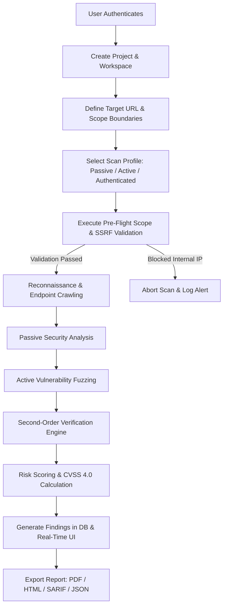
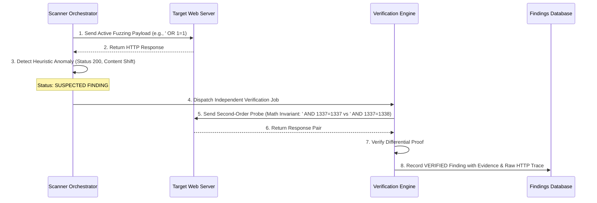
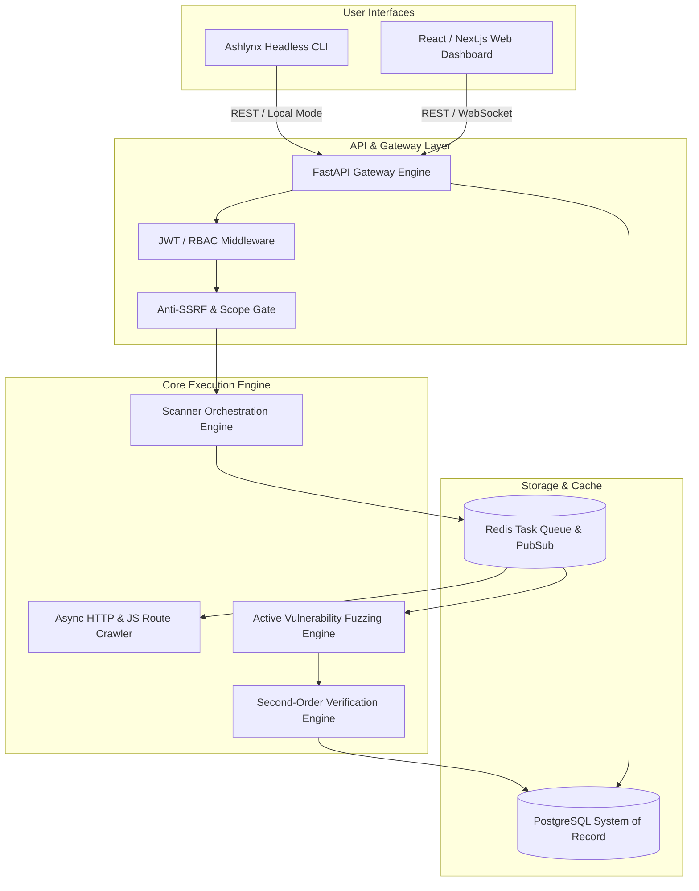
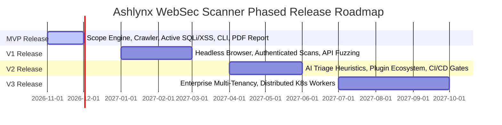
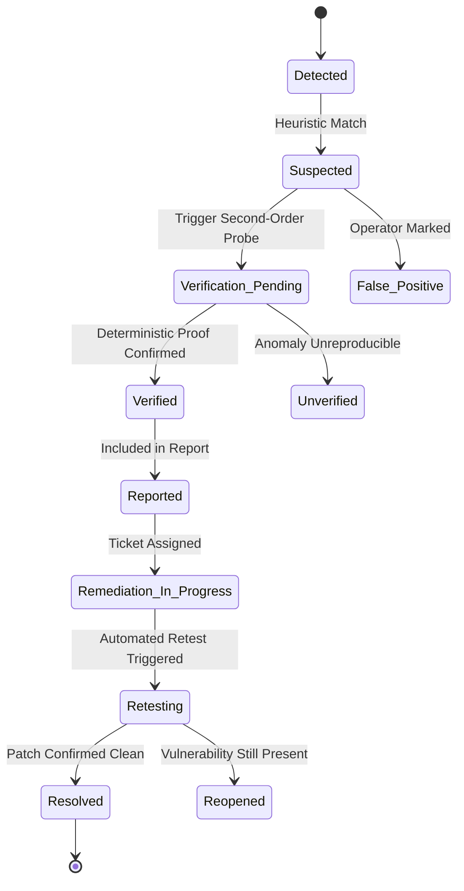

# ASHLYNXCYBER SECURITY SYSTEMS

# Ashlynx WebSec Scanner
## Comprehensive Master Product Requirements Document (PRD) & Engineering Specification
### An Extensible Web Application Security Assessment, DAST & Automated Vulnerability Scanning Platform
**Operating System Category:** Enterprise Cyber Security & Application Security Testing (DAST)  
**Document Identification:** PRD-WSS-2026-V2.0-FINAL  
**Current Date:** 24 November 2026  
**Document Release:** Version 2.0 (Complete Master Baseline)  
**Security Classification:** Internal — Confidential (AshlynxCyber)  

---

## 00. Cover Page
```
================================================================================
                      ASHLYNXCYBER SECURITY SYSTEMS
================================================================================
                       Ashlynx WebSec Scanner
             Automated DAST & Web Vulnerability Assessment Platform
================================================================================
  Document Title:        Comprehensive Master Product Requirements Document (PRD)
  Document Identifier:   PRD-WSS-2026-V2.0-FINAL
  Product Category:      Dynamic Application Security Testing (DAST) & Recon
  Interface Paradigm:    Hybrid (Web Dashboard + Headless CLI)
  Target Release Model:  Phased Delivery (MVP -> V1 -> V2 -> V3)
  Organization:          AshlynxCyber (https://www.ashlynxcyber.in/)
  Author:                Hala Naaz (Lead Security Architect & Product Engineer)
  Document Status:       Under Formal Architecture Review (Gate G1/G2 Alignment - Draft)
  Distribution:          Product, Application Security, Engineering, DevSecOps
================================================================================
```

---

## 01. Document Control
| Field | Value |
| :--- | :--- |
| **Document Title** | Ashlynx WebSec Scanner: Comprehensive Master Product Requirements Document |
| **Product Identifier** | AWSS-CORE |
| **Document Owner** | Product & Security Engineering, AshlynxCyber |
| **Author** | Hala Naaz |
| **Document Version** | 2.0 (Complete Master Baseline) |
| **Document Status** | Under Formal Architecture Review (Gate G1/G2 Alignment - Draft) |
| **Classification** | Internal — Confidential |
| **Product Ownership** | AshlynxCyber Security Systems |
| **Intended Use** | Authoritative single source of truth for architectural planning, security review, and agentic implementation |
| **Document Scope** | Complete product lifecycle, functional and technical specifications across Sections 00–44 and Appendices A–M |

---

## 02. Revision History and Approvals

### Revision History
| Version | Date | Author | Description of Changes |
| :--- | :--- | :--- | :--- |
| **0.1** | 04 Nov 2026 | Hala Naaz | Initial scope synthesis, market assessment, and structural outline |
| **0.5** | 12 Nov 2026 | Hala Naaz | DAST engine architecture, scan profiles, and vulnerability matrix addition |
| **0.8** | 18 Nov 2026 | Hala Naaz | Added verification engine, STRIDE threat model, database schemas, and REST APIs |
| **1.0** | 24 Nov 2026 | Hala Naaz | Initial baseline PRD structure |
| **2.0** | 24 Nov 2026 | Hala Naaz | Complete Master PRD expansion: full actual content for Sections 15–44, Appendices A–M, persona standardization (five exact uppercase names + unnamed CISO), unvalidated metrics marked as proposed hypotheses, competitive claims cited with access dates. |

### Review and Approvals (Pending Formal Sign-off Gates)
| Role | Designated Reviewer | Responsibility | Status |
| :--- | :--- | :--- | :--- |
| **Product Owner** | Senior Product Manager | Scope alignment, release priorities, persona validation | Under Review |
| **Security Architect** | Principal AppSec Architect | Scanner threat model, SSRF protection, verification rigor | Under Review |
| **Engineering Lead** | Software & DAST Architect | Feasibility, module contracts, database performance | Under Review |
| **QA / Testing Lead** | Security Testing Lead | Test strategy, benchmarking methodology, and acceptance gates | Under Review |

---

## Table of Contents
* **SECTION A — PRODUCT DEFINITION**
  * 00. Cover Page
  * 01. Document Control
  * 02. Revision History and Approvals
  * 03. Executive Summary
  * 04. Product Background and Problem Statement
  * 05. Product Vision and Strategic Objectives
  * 06. Goals, Non-Goals and Success Criteria
  * 07. Market and Competitive Analysis
  * 08. Target Users and User Personas
  * 09. Use Cases and User Journeys
  * 10. Scope and Boundaries
* **SECTION B — PRODUCT REQUIREMENTS**
  * 11. Functional Requirements
  * 12. Vulnerability Coverage Matrix
  * 13. Scanning Modes and Profiles
  * 14. Reconnaissance and Attack Surface Discovery
  * 15. Detection and Verification Engine
  * 16. Risk Intelligence and Prioritization
  * 17. Reporting and Export Requirements
  * 18. Dashboard and UI/UX Requirements
  * 19. User Roles and Permissions
* **SECTION C — TECHNICAL AND ENGINEERING SPECIFICATIONS**
  * 20. System Architecture
  * 21. Module and Plugin Architecture
  * 22. Database and Data Model
  * 23. API Architecture and Integrations
  * 24. Non-Functional Requirements
  * 25. Security, Privacy and Threat Model
  * 26. Deployment and Infrastructure
  * 27. Testing and Quality Assurance
* **SECTION D — PRODUCT EVOLUTION AND DELIVERY**
  * 28. Benchmarking and Competitive Evaluation
  * 29. Success Metrics, Development Roadmap and Future Expansion
* **SECTION E — ADVANCED ARCHITECTURE, GOVERNANCE & LIFECYCLE (SECTIONS 30–44)**
  * 30. Product Principles and Design Philosophy
  * 31. Product Assumptions, Constraints and Dependencies
  * 32. Product Packaging, Licensing and Distribution
  * 33. Authentication and Session Management
  * 34. Scan Orchestration and Job Management
  * 35. Vulnerability Finding Lifecycle
  * 36. Evidence Collection and Integrity
  * 37. API and Modern Application Compatibility
  * 38. Plugin and Extension Security
  * 39. AI Security and AI Governance
  * 40. Enterprise and Multi-Tenant Architecture
  * 41. Observability and Operational Management
  * 42. Data Governance and Privacy
  * 43. Disaster Recovery and Business Continuity
  * 44. Accessibility, Localization and Usability
* **SECTION F — APPENDICES (APPENDICES A–M)**
  * Appendix A. Functional Requirements Catalogue
  * Appendix B. Non-Functional Requirements Catalogue
  * Appendix C. Vulnerability Coverage Matrix
  * Appendix D. Requirements Traceability Matrix
  * Appendix E. Glossary and Technical Terminology
  * Appendix F. Acronyms and Abbreviations
  * Appendix G. Research References and Standards
  * Appendix H. API and Data Schema References
  * Appendix I. Architecture Diagrams
  * Appendix J. Product and Technical Risk Register
  * Appendix K. Open Questions, Assumptions and Deferred Decisions
  * Appendix L. Release-wise Feature Allocation Matrix
  * Appendix M. Acceptance Criteria Catalogue

---

## 03. Executive Summary
**Ashlynx WebSec Scanner** is an enterprise-grade, hybrid web application vulnerability assessment platform engineered by AshlynxCyber. Designed to bridge the gap between noisy, unverified vulnerability scanners and labor-intensive manual penetration testing, the platform combines **automated attack surface reconnaissance**, **high-performance crawling**, **active vulnerability detection**, **independent evidence verification**, and **risk prioritization** into a unified operational workflow.

### The Hybrid Architecture
The system natively provides two complementary interfaces operating over a single, deterministic core engine:
1. **Interactive Web Dashboard:** Delivering multi-tenant workspace management, visual scan configuration, real-time finding feeds, interactive evidence viewers, and executive/technical report generation.
2. **Headless Command-Line Interface (CLI):** Optimized for security researchers, penetration testers, and automated DevSecOps CI/CD pipelines, supporting configuration-as-code and structured SARIF/JSON outputs.

### Strategic Differentiation
Unlike conventional scanners that flood security teams with false-positive reflections or unverified headers, Ashlynx WebSec Scanner enforces **two-phase verification**: distinguishing *suspected* anomalies from *independently verified* vulnerabilities using deterministic second-order probes, out-of-band (OOB) validation, and mathematical differential testing.

---

## 04. Product Background and Problem Statement

### 4.1 The Current State of Web Application Vulnerability Scanning
Modern web applications have evolved from static, multi-page HTML forms into complex, client-rendered Single Page Applications (SPAs), microservices, and API-driven backends (REST, GraphQL, gRPC). Traditional DAST scanners have failed to keep pace, creating severe operational friction:

```
+─────────────────────────────────────────────────────────────────────────────+
|               TRADITIONAL DAST PAIN POINTS & SCANNER FAILURES               |
+─────────────────────────────────────────────────────────────────────────────+
| 1. High False-Positive Rates: Flagging cosmetic reflection as valid XSS/SSTI|
| 2. Shallow Attack Surface Discovery: Inability to parse client-side JS routes|
| 3. Fragile Authentication: Sessions terminate mid-scan without re-login     |
| 4. Self-Weaponization & SSRF: Scanners abused to probe internal cloud IP CIDR|
| 5. Fragmented Toolchains: Testers juggle 5 CLI scripts + 2 heavy GUI tools   |
+─────────────────────────────────────────────────────────────────────────────+
```

### 4.2 Core Problems Addressed
1. **The False-Positive Fatigue Dilemma:** Security engineers spend up to 40% of their time manually triaging scanner outputs (Industry Benchmark Hypothesis). Ashlynx WebSec Scanner eliminates this by requiring deterministic execution proof before labeling a finding as `VERIFIED`.
2. **Uninstrumented SPA & API Blindspots:** Legacy crawlers see only initial HTML shells. Ashlynx WebSec Scanner incorporates JavaScript static AST route parsing and deep API specification ingestion (OpenAPI/Swagger, GraphQL introspection).
3. **Scanner-Side Vulnerabilities & Weaponization:** Attackers frequently manipulate targets to induce scanners into hitting cloud metadata endpoints (`169.254.169.254`) or internal databases. Ashlynx WebSec Scanner mandates socket-level DNS resolution pinning, egress validation, and strict scope boundary enforcement.

---

## 05. Product Vision and Strategic Objectives

### 5.1 Product Vision Statement
To establish Ashlynx WebSec Scanner as the industry standard open-source/enterprise hybrid security assessment platform, empowering individual researchers and enterprise teams to uncover, verify, and remediate genuine application vulnerabilities with zero fluff and complete mathematical precision.

### 5.2 Phased Strategic Horizon
* **Short-Term (MVP):** Deliver a robust, lightweight, standalone CLI and Web Dashboard executing passive analysis, endpoint discovery, and high-impact active checks (SQLi, reflected XSS, open redirects, security header misconfigurations) with strict scope validation.
* **Medium-Term (V1 - V2):** Integrate headless browser crawling (Playwright), authenticated stateful session replay, REST/GraphQL automated fuzzing, and AI-assisted triage heuristics.
* **Long-Term (V3):** Expand to multi-tenant enterprise clusters, distributed worker orchestration (Kubernetes), attack-chain correlation, and bidirectional SIEM/SOAR/DefectDojo integrations.

---

## 06. Goals, Non-Goals and Success Criteria

### 6.1 Product Goals
* **G-01:** Build a unified scanning engine accessible via both a rich web dashboard and a scriptable CLI.
* **G-02:** Provide automated discovery of endpoints, query parameters, hidden form fields, and JavaScript routes.
* **G-03:** Provide mathematically verified detection for critical OWASP Top 10 and OWASP API Top 10 vulnerabilities.
* **G-04:** Provide non-bypassable server-side scope and SSRF egress enforcement.
* **G-05:** Output industry-standard reports in Markdown, PDF, HTML, JSON, and SARIF formats.

### 6.2 Non-Goals
* **NG-01:** Replacing Static Application Security Testing (SAST) or Software Composition Analysis (SCA) source code tools.
* **NG-02:** Operating as a real-time inline Web Application Firewall (WAF) or Intrusion Detection System (IDS).
* **NG-03:** Automatic exploit weaponization or post-exploitation lateral movement (the platform verifies, it does not compromise).
* **NG-04:** Conducting unauthorized wide-scale public internet sweeps or port scanning (nmap-replacement).

### 6.3 Measurable Success Criteria
| Metric ID | Objective | Target (Proposed Hypothesis) | Measurement Method |
| :--- | :--- | :--- | :--- |
| **SC-01** | False-Positive Rate on Benchmark Suite | < 5% on verified findings (Proposed Target) | Evaluation against OWASP Benchmark v1.2 & Juice Shop |
| **SC-02** | Scan Execution Throughput | ≥ 30 HTTP req/sec per worker (Target Hypothesis) | Benchmarked on local containerized targets |
| **SC-03** | Scope Escape Rate | 0.00% (Strict zero-tolerance) | Automated regression test suite with redirect traps |
| **SC-04** | CLI Command Startup Time | < 500 ms to initialization (Proposed Target) | Time-to-first-request execution |
| **SC-05** | Core Engine Unit & Integration Test Coverage | ≥ 85% line coverage | Pytest coverage reporting in CI |

---

## 07. Market and Competitive Analysis

The competitive assessment below compares Ashlynx WebSec Scanner against established security platforms based on publicly available documentation, user guides, and research publications (accessed November 2026).

| Evaluation Criterion | OWASP ZAP [1] | Burp Suite Professional [2] | ProjectDiscovery Nuclei [3] | Invicti / Acunetix [4] | Ashlynx WebSec Scanner (Target) |
| :--- | :--- | :--- | :--- | :--- | :--- |
| **Primary Paradigm** | Desktop GUI / Intercepting Proxy | Desktop GUI / Pentest Powerhouse | Headless CLI / Fast Template Scanner | Enterprise Cloud / On-Prem SaaS | **Native Hybrid (Web Dashboard + Fast CLI)** |
| **Extensibility** | Java / Python Scripting | BApp Store (Java/Python) | YAML Templates | Proprietary Plugins | **Python Modules + YAML Heuristic Signatures** |
| **Verification Rigor** | Heuristic matching | Manual / Active Scanner Heuristics | Matcher-based (regex/status) | Proof-based verification | **Two-Phase Verification (Suspected vs. Verified)** |
| **JavaScript SPA Crawling** | AJAX Spider (moderate) | Embedded Chromium Crawler (High) | None (Request-based) | Custom Headless Engine | **Tiered (Static AST Regex in MVP; Playwright in V1)** |
| **API Security Assessment** | OpenAPI add-on | Manual OpenAPI/GraphQL support | Targeted templates | Built-in API parser | **Built-in OpenAPI v3 & GraphQL Schema Fuzzing** |
| **CI/CD Integration** | ZAP Automation Framework | Burp Enterprise / CLI | Native CLI / GitHub Actions | Enterprise API connectors | **Native Headless CLI + SARIF / JSON Pipeline Gate** |
| **Scanner Self-Security** | Configurable upstream proxy | Local sandbox rules | User-governed | Enterprise cloud egress | **Kernel/Socket-level SSRF Pinning & Egress Gate** |

*Citations & References:*  
[1] OWASP ZAP Project Documentation, `zaproxy.org/docs/`, accessed Nov 2026.  
[2] PortSwigger Web Security, *Burp Suite User Guide & DAST Scanner Architecture*, `portswigger.net`, accessed Nov 2026.  
[3] ProjectDiscovery, *Nuclei Engine Documentation and Template Protocols*, `docs.projectdiscovery.io`, accessed Nov 2026.  
[4] Invicti Security, *Proof-Based Scanning Verification Technology Whitepaper*, `invicti.com`, accessed Nov 2026.

---

## 08. Target Users and User Personas

> **Persona Labeling Standard:** Personas represent functional role archetypes across product workflows. The five personal names below are standardized documentation identifiers. The sixth persona maintains its executive workflow under an unnamed role-based label pending formal naming review.

### Persona 1: HALA NAAZ — Independent Bug Bounty Researcher
* **Persona ID:** `PERS-01`
* **Name / Label:** HALA NAAZ
* **Professional Role:** Independent Security Researcher & Bug Bounty Hunter
* **Profile:** Specializes in web application and API security across authorized vulnerability disclosure and bug bounty programs (HackerOne, Bugcrowd).
* **Goals:** Rapidly map unknown attack surfaces, automate repetitive endpoint discovery, and eliminate false-positive reflections to focus exclusively on verifiable, high-payout flaws.
* **Responsibilities:** Submitting clear, reproducible, high-signal vulnerability reports with validated proof-of-concept steps.
* **Workflow:** Reconnaissance $
ightarrow$ JavaScript route extraction $
ightarrow$ targeted active injection fuzzing $
ightarrow$ verification validation $
ightarrow$ raw HTTP trace export.
* **Pain Points:** Traditional scanners flood terminal outputs with unverified noise, lack flexible scope regex rules, and cannot parse modern client-side JavaScript routes.
* **Product Interaction:** Interacts predominantly via the headless CLI: `ashlynx scan --target target.com --scope-file inscope.txt --mode active --format json`.
* **Expected Product Value:** Target 60% reduction in manual discovery time (Hypothesis); automated generation of client-ready proof-of-concept evidence.
* **Relevant Features:** Headless CLI, JS AST parser, strict scope gating, SARIF/JSON export.

### Persona 2: MOHAMMAD ASHRAF SAMI — Senior Application Security Engineer
* **Persona ID:** `PERS-02`
* **Name / Label:** MOHAMMAD ASHRAF SAMI
* **Professional Role:** Senior Application Security Engineer
* **Profile:** Leads internal AppSec and vulnerability management across 40+ microservices and customer-facing web platforms in a mid-sized enterprise.
* **Goals:** Embed automated security testing gates into engineering CI/CD pipelines without delaying build deployments or alienating developers with false alarms.
* **Responsibilities:** Setting application security standards, triaging vulnerability alerts, validating developer remediations, and maintaining compliance posture.
* **Workflow:** Automated nightly pipeline triggering $
ightarrow$ review of diff scans $
ightarrow$ assignment of Jira tickets with verified evidence $
ightarrow$ retest validation.
* **Pain Points:** Developers push back on unverified scanner findings; lack of reproducible HTTP artifacts slows down remediation.
* **Product Interaction:** Configures scan profiles in the Web Dashboard; reviews automated SARIF ingestion in GitLab CI/CD; uses the Retest feature.
* **Expected Product Value:** Low false-positive rate; automated retesting of remediated findings; seamless CI/CD integration.
* **Relevant Features:** CI/CD exit codes, SARIF format, Vulnerability Drawer, Retest engine, RBAC.

### Persona 3: MOHAMMED ASHAR — Professional Penetration Tester & Security Consultant
* **Persona ID:** `PERS-03`
* **Name / Label:** MOHAMMED ASHAR
* **Professional Role:** Principal Security Consultant & Penetration Tester
* **Profile:** Delivers time-boxed, authorized dynamic assessments and commercial web pentests for enterprise clients.
* **Goals:** Efficiently uncover OWASP Top 10 vulnerabilities, bypass noisy manual documentation, and generate branded, executive-ready penetration testing reports.
* **Responsibilities:** Performing deep technical vulnerability testing, verifying real business impact, and delivering client walkthroughs.
* **Workflow:** Client onboarding $
ightarrow$ scope lockdown $
ightarrow$ authenticated scanning $
ightarrow$ manual verification $
ightarrow$ executive report export.
* **Pain Points:** Formatting client reports takes hours of tedious manual screenshotting and Markdown editing.
* **Product Interaction:** Drives the Web Dashboard during active assessments; utilizes authenticated scanning profiles; exports branded PDF/HTML reports.
* **Expected Product Value:** Comprehensive PDF reports with raw evidence, CVSS 4.0 metrics, and developer remediation code.
* **Relevant Features:** Authenticated scan profiles, Executive & Technical PDF export, Side-by-side evidence viewer.

### Persona 4: MAIMOONAH PARVEEN — DevSecOps Pipeline Architect
* **Persona ID:** `PERS-04`
* **Name / Label:** MAIMOONAH PARVEEN
* **Professional Role:** DevSecOps Architect & Platform Engineer
* **Profile:** Designs and maintains organizational CI/CD infrastructure, Kubernetes developer platforms, and automated security verification tooling.
* **Goals:** Provide development squads with lightweight, scriptable, container-native security scanning tools that run reliably in ephemeral cloud runners.
* **Responsibilities:** Ensuring CI pipeline health, enforcing pipeline security gates, and scaling security scanners horizontally.
* **Workflow:** Docker container orchestration $
ightarrow$ environment variable injection $
ightarrow$ headless scan execution $
ightarrow$ SARIF artifact ingestion.
* **Pain Points:** Legacy GUI scanners are too heavy, consume 4 GB+ of runner RAM, and lack native Linux container support.
* **Product Interaction:** Executes Ashlynx CLI inside Docker containers in GitHub Actions / Kubernetes ephemeral pods.
* **Expected Product Value:** Sub-500ms CLI startup (Proposed Target); lightweight footprint (< 250 MB RAM); zero-hang reliability.
* **Relevant Features:** Docker packaging, headless CLI, SARIF reporting, zero external runtime dependencies.

### Persona 5: MAIMOONAH NAAZ — Full-Stack Developer
* **Persona ID:** `PERS-05`
* **Name / Label:** MAIMOONAH NAAZ
* **Professional Role:** Full-Stack Software Engineer (Python, React, FastAPI)
* **Profile:** Builds modern client-facing applications and REST APIs; values clean, actionable code reviews over security jargon.
* **Goals:** Test feature branches locally before merging into `main`; understand exactly why a vulnerability exists and how to patch it.
* **Responsibilities:** Developing secure application features, fixing reported security defects, and maintaining clean code.
* **Workflow:** Local code build $
ightarrow$ `ashlynx scan http://localhost:8000` $
ightarrow$ inspect finding remediation snippet $
ightarrow$ apply patch $
ightarrow$ re-scan.
* **Pain Points:** Generic security warnings that do not provide the vulnerable code context or how to write the fix.
* **Product Interaction:** Uses CLI locally; reads the remediation code recommendations in reports and dashboard drawers.
* **Expected Product Value:** Actionable, framework-specific code fixes; immediate verification of patches.
* **Relevant Features:** Fast Scan mode, Remediation code snippets, Developer-friendly CLI logs.

### Persona 6: [ROLE-BASED PERSONA: CISO / SECURITY EXECUTIVE - UNNAMED (PENDING NOMINATION)]
* **Persona ID:** `PERS-06`
* **Name / Label:** [ROLE-BASED PERSONA: CISO / SECURITY EXECUTIVE - UNNAMED (PENDING NOMINATION)]
* **Professional Role:** Chief Information Security Officer (CISO) / Executive Security Director
* **Profile:** Owns organizational cyber risk posture, compliance reporting (SOC 2, ISO 27001), and executive board presentations.
* **Goals:** Gain instant, unvarnished visibility into organizational web asset risk posture and confirm that vulnerability trends are declining.
* **Responsibilities:** Managing cyber risk, defending security budgets, reporting to the executive board and audit committee.
* **Workflow:** Monthly review of Executive Dashboard $
ightarrow$ tracking MTTR and critical vulnerability backlogs $
ightarrow$ exporting executive summaries.
* **Pain Points:** Technical security reports are too dense and lack high-level business risk translation.
* **Product Interaction:** Periodically logs into the Executive Dashboard view; downloads one-click executive PDF summaries.
* **Expected Product Value:** High-level risk score trends, compliance mapping, and audit-ready reporting.
* **Relevant Features:** Executive Dashboard, Mean Time to Remediate (MTTR) analytics, Executive PDF reports.
* **Open Decision Note (OD-PERS-06):** In accordance with governance instructions, this sixth persona maintains its distinct executive role and workflow under an unnamed role-based designation pending formal stakeholder naming review.

---

## 09. Use Cases and User Journeys



### Key Operational Journeys
1. **UC-01: Headless CI/CD Pipeline Scanning:** A developer pushes code; GitHub Actions invokes the Ashlynx CLI; the scanner executes an active scan against the staging URL, detects a reflected XSS, verifies it, outputs a SARIF file, and fails the build.
2. **UC-02: Authenticated Web App Penetration Test:** A pentester logs into the Web Dashboard, inputs an authorized client domain, configures form-based login credentials, executes an authenticated scan, reviews the real-time finding drawer, and downloads an executive PDF.
3. **UC-03: Retest & Remediation Verification:** An AppSec engineer selects an existing finding marked as "Patched" by developers and triggers a single-finding targeted retest to confirm remediation.

---

## 10. Scope and Boundaries

### 10.1 In-Scope Capabilities
* Automated crawling and endpoint extraction (HTML, forms, JavaScript source maps, robots.txt, sitemaps).
* Passive security checks (TLS/SSL configurations, security headers, cookie flags, information disclosure).
* Active vulnerability assessment (SQLi, XSS, SSRF, Command Injection, Path Traversal, Open Redirects, CORS misconfigurations).
* Multi-mode authentication support (Cookie injection, Authorization headers, automated form-login).
* Deterministic evidence-based vulnerability verification.
* Comprehensive report generation (PDF, HTML, JSON, CSV, SARIF).

### 10.2 Out-of-Scope Capabilities
* Binary fuzzing or memory corruption vulnerability detection (buffer overflows).
* Distributed Denial of Service (DDoS) stress-testing or volumetric network attacks.
* Automated social engineering or phishing simulation.
* Reverse-engineering compiled thick-client desktop binaries.

---

## 11. Functional Requirements (FR)

All functional requirements follow the strict documentation standard:

### Module 1: Project & Target Management
* **FR-PRJ-001: Project Creation and Isolation**
  * **Requirement ID:** `FR-PRJ-001`
  * **Description:** The system shall allow users to create isolated project containers to group targets, scans, and findings.
  * **Business Justification:** Prevents data mixing across client engagements and business units.
  * **Priority:** Must | **Release:** MVP | **Dependencies:** None
  * **Preconditions:** Authenticated user with `Operator` role or higher.
  * **Inputs:** Project name (string, 3–50 chars), optional description.
  * **Expected Behavior:** System creates project entity, generates UUID, and sets owner tenant ID.
  * **Security Considerations:** Enforces tenant boundary isolation at query level.
  * **Acceptance Criteria (AC-PRJ-001):** User cannot see or access projects belonging to other tenants.
  * **Verification Method:** Multi-tenant automated integration test asserting query isolation.

* **FR-PRJ-002: Target Asset Registration**
  * **Requirement ID:** `FR-PRJ-002`
  * **Description:** The system shall register target base URLs and validate their URI syntax.
  * **Business Justification:** Establishes the authoritative root asset for scan jobs.
  * **Priority:** Must | **Release:** MVP | **Dependencies:** `FR-PRJ-001`
  * **Inputs:** FQDN or URL string (`https://example.com`).
  * **Expected Behavior:** URL parsed, canonicalized, and stored in target inventory.
  * **Security Considerations:** Normalizes port and path to prevent canonicalization bypass.
  * **Acceptance Criteria (AC-PRJ-002):** Malformed URLs rejected with clear formatting errors.
  * **Verification Method:** Unit tests passing valid and invalid URL strings.

### Module 2: Scope & Authorization Enforcement
* **FR-SCP-001: Strict Scope Boundary Definition**
  * **Requirement ID:** `FR-SCP-001`
  * **Description:** The system shall accept regex, wildcard, and CIDR rules defining permitted target boundaries.
  * **Business Justification:** Protects legal liability by preventing unauthorized active scans.
  * **Priority:** Must | **Release:** MVP | **Dependencies:** `FR-PRJ-002`
  * **Inputs:** Inclusion rules (e.g., `*.example.com`), exclusion rules (e.g., `*.example.com/logout`).
  * **Expected Behavior:** Core dispatcher evaluates every URL before request dispatch against scope rules.
  * **Security Considerations:** Prevents inadvertent scanning of out-of-scope third-party infrastructure.
  * **Acceptance Criteria (AC-SCP-001):** 100% of out-of-scope URLs, including those discovered via links, are discarded without firing active payloads.
  * **Verification Method:** Negative test asserting external redirect URL is dropped from fuzz queue.

* **FR-SCP-002: Anti-SSRF Socket Egress Validation**
  * **Requirement ID:** `FR-SCP-002`
  * **Description:** The scanner shall resolve target hostnames immediately before socket creation and block all private RFC 1918, loopback, and cloud metadata addresses.
  * **Business Justification:** Prevents the scanner from being weaponized against internal cloud networks.
  * **Priority:** Must | **Release:** MVP | **Dependencies:** None
  * **Expected Behavior:** Validates IP against `10.0.0.0/8`, `172.16.0.0/12`, `192.168.0.0/16`, `127.0.0.0/8`, `169.254.169.254`.
  * **Security Considerations:** Blocks DNS rebinding attacks via socket-level IP pinning.
  * **Acceptance Criteria (AC-SCP-002):** Target resolving to `169.254.169.254` or `127.0.0.1` is aborted before any HTTP payload is transmitted.
  * **Verification Method:** Unit test asserting socket connection is blocked for metadata IP.

### Module 3: Reconnaissance & Crawling
* **FR-REC-001: JavaScript Route & Endpoint Extraction**
  * **Requirement ID:** `FR-REC-001`
  * **Description:** The crawler shall parse client-side `.js` files using AST and regex to extract hidden API paths and URL parameters.
  * **Business Justification:** Discovers unlinked API attack surfaces in modern SPAs.
  * **Priority:** Must | **Release:** MVP | **Dependencies:** `FR-SCP-001`
  * **Expected Behavior:** Discovers relative paths (`/api/v1/...`) and query parameters; queues them for active scanning.
  * **Acceptance Criteria (AC-REC-001):** Extracts endpoints from inline scripts and external script bundles.
  * **Verification Method:** Test against fixture JS bundle containing obfuscated routes.

* **FR-CRW-001: Asynchronous Scope-Bound HTTP Crawler**
  * **Requirement ID:** `FR-CRW-001`
  * **Description:** The system shall recursively crawl HTML links, form actions, and meta tags up to a configured max depth.
  * **Business Justification:** Maps application page hierarchy rapidly without heavy browser overhead.
  * **Priority:** Must | **Release:** MVP | **Dependencies:** `FR-SCP-001`
  * **Inputs:** Max crawl depth (integer, default: 3), max URLs (integer, default: 500).
  * **Acceptance Criteria (AC-CRW-001):** Respects exclusion paths (e.g., `/logout`, `/delete`) to prevent session invalidation or state corruption.
  * **Verification Method:** Crawl test on local testbed asserting `/logout` is never requested.

### Module 4: Active Vulnerability Scanning
* **FR-ACT-001: SQL Injection Detection Module**
  * **Requirement ID:** `FR-ACT-001`
  * **Description:** The engine shall test input parameters for in-band, error-based, and time-based blind SQL injection vulnerabilities.
  * **Business Justification:** Identifies high-impact database compromise risks.
  * **Priority:** Must | **Release:** MVP | **Dependencies:** `FR-CRW-001`
  * **Expected Behavior:** Injects mathematical probes (e.g., `' AND 5432=5432--`, `' AND 5432=5433--`), checks response differentials and database syntax error strings.
  * **Acceptance Criteria (AC-ACT-001):** Detects error-based and boolean-differential SQLi without generating false positives on dynamic numerical inputs.
  * **Verification Method:** Scan test against DVWA SQLi endpoint.

* **FR-ACT-002: Cross-Site Scripting (XSS) Detection Module**
  * **Requirement ID:** `FR-ACT-002`
  * **Description:** The engine shall test for reflected XSS by injecting unique alphanumeric context probes and checking reflection contexts.
  * **Business Justification:** Identifies client-side account takeover vulnerabilities.
  * **Priority:** Must | **Release:** MVP | **Dependencies:** `FR-CRW-001`
  * **Expected Behavior:** Evaluates whether probe is reflected raw, HTML-entity-encoded, or inside script blocks.
  * **Acceptance Criteria (AC-ACT-002):** Accurately flags unescaped reflections inside HTML tags and executable JavaScript contexts.
  * **Verification Method:** Scan test against Juice Shop search endpoint.

* **FR-ACT-003: Server-Side Request Forgery (SSRF) Module**
  * **Requirement ID:** `FR-ACT-003`
  * **Description:** The engine shall test URL parameters against out-of-band (OOB) listener domains to detect blind and full SSRF.
  * **Business Justification:** Identifies dangerous internal service pivot vectors.
  * **Priority:** Must | **Release:** MVP | **Dependencies:** `FR-CRW-001`
  * **Acceptance Criteria (AC-ACT-003):** Identifies when target fetches the external listener token.
  * **Verification Method:** Integration test with mock DNS/HTTP listener callback.

### Module 5: Two-Phase Verification Engine
* **FR-VRF-001: Deterministic Verification Execution**
  * **Requirement ID:** `FR-VRF-001`
  * **Description:** Every suspected finding from the active scanner shall trigger an independent, non-destructive verification probe.
  * **Business Justification:** Eliminates false alarms before reporting.
  * **Priority:** Must | **Release:** MVP | **Dependencies:** `FR-ACT-001`
  * **Expected Behavior:** If SQLi suspected, fires randomized mathematical equivalence tests. If SSTI suspected, fires randomized arithmetic evaluation (`{{1337*7}}`).
  * **Outputs:** State updated from `SUSPECTED` to `VERIFIED` with raw execution proof.
  * **Acceptance Criteria (AC-VRF-001):** Unverified findings are strictly labeled as `SUSPECTED / UNVERIFIED` in reports.
  * **Verification Method:** Test asserting finding without secondary proof is marked unverified.

---

## 12. Vulnerability Coverage Matrix

| Category | Vulnerability Type | CWE ID | OWASP Web | OWASP API | Detection Method | Verification Method | Supported Scan Mode | Release | Known Limitations |
| :--- | :--- | :--- | :--- | :--- | :--- | :--- | :--- | :--- | :--- |
| **Injection** | SQL Injection (Error/Boolean) | CWE-89 | A03:2021 | API8:2023 | Differential Anomaly | Arithmetic Invariant Probes | Active, Full | MVP | WAF rate-limiting can delay time-based blind checks |
| **Injection** | Reflected Cross-Site Scripting | CWE-79 | A03:2021 | — | Polyglot Context Reflection | AST Syntax Execution Simulation | Active, Full | MVP | Complex DOM-based sinks require V1 browser crawler |
| **Injection** | Server-Side Template Injection | CWE-1336 | A03:2021 | — | Syntax Interpolation | Dynamic Math Eval (`${{7*7}}`) | Active, Full | MVP | Template engine sandbox restrictions |
| **Broken Auth** | Insecure Session Cookie Flags | CWE-614 | A01:2021 | API2:2023 | Response Header Inspection | Deterministic Attribute Check | Passive, Active | MVP | None (Deterministic static check) |
| **Misconfig** | Missing Security Headers (CSP, HSTS)| CWE-16 | A05:2021 | API7:2023 | Passive Header Parsing | Policy Compliance Evaluator | Passive, Active | MVP | None |
| **Misconfig** | Over-Permissive CORS Policy | CWE-942 | A05:2021 | API7:2023 | Origin Reflection Injection | Null / Custom Origin Match | Active, Full | MVP | Authenticated CORS requires V1 credentials |
| **Broken Auth** | Broken Object Level Auth (BOLA)| CWE-639 | A01:2021 | API1:2023 | Cross-Tenant Parameter Replay | HTTP Differential Status Check | Authenticated, API | V1 | Requires two valid tenant account contexts |
| **SSRF** | Server-Side Request Forgery | CWE-918 | A10:2021 | API7:2023 | Out-of-Band Listener Probe | Dedicated DNS/HTTP Callback | Active, Full | MVP | Air-gapped targets cannot hit public OOB listener |
| **Traversal** | Path Traversal / File Inclusion | CWE-22 | A01:2021 | — | Relative Root Traversal | Known System File Fingerprint | Active, Full | MVP | Chrooted target server environments |
| **Redirect** | Unvalidated Open Redirect | CWE-601 | A01:2021 | — | Location Header Fuzzing | Target Egress Whitelist Check | Active, Full | MVP | Client-side JavaScript redirects (V1 browser) |

---

## 13. Scanning Modes and Profiles

| Profile Name | Crawl Depth | Active Payloads Fired | Authentication | Execution Time (Hypothesis) | Intended Context |
| :--- | :---: | :---: | :---: | :---: | :--- |
| **Passive Discovery** | Deep (5) | None (Passive only) | Optional | Very Fast (< 2 min) | Non-intrusive recon, header auditing |
| **Quick Assessment** | Shallow (2) | High-severity injection only | No | Fast (< 5 min) | CI/CD smoke test, pull request check |
| **Full Assessment** | Deep (5) | Complete payload suite | Optional | Thorough (15–45 min) | Comprehensive scheduled assessment |
| **Authenticated Scan** | Deep (5) | Full payload suite + BOLA | Mandatory | In-Depth (30–60 min) | Authorized penetration testing |
| **API Targeted** | N/A (Spec-based) | OpenAPI / GraphQL fuzzing | Bearer / Key | High-efficiency | Microservice backend testing |
| **Safe Mode** | Standard (3) | Read-only / Non-state altering | Optional | Standard | Production environments |

---

## 14. Reconnaissance and Attack Surface Discovery

### 14.1 Authorized Asset Discovery
The reconnaissance engine discovers and catalogs web application assets strictly within authorized domain scope boundaries:
1. **HTTP Baseline Header & Metadata Harvest:** Queries root endpoints to analyze `Server`, `X-Powered-By`, TLS certificate Common Names / Subject Alternative Names (SANs), and cookie security attributes.
2. **Sitemap & Robots.txt Ingestion:** Parses `/robots.txt` for disallow rules and `/sitemap.xml` for structural endpoint listings, mapping hidden administrative paths.

### 14.2 URL and Parameter Discovery
* **DOM Form Cataloging:** Extracts every `<form action="..." method="...">`, capturing input fields, hidden tokens, and CSRF protection parameters.
* **Query Parameter Normalization:** De-duplicates URLs with identical parameter structures (e.g., `/item?id=1` and `/item?id=2` normalized to a single fuzzable endpoint pattern).

### 14.3 Client-Side JavaScript Route Analysis
Modern SPAs load API routes dynamically within client bundles. The AST route extractor:
* Downloads all linked `.js` script tags and sourcemaps.
* Tokenizes script content using regular expressions and abstract syntax patterns matching route definitions (e.g., `axios.get('/api/...')`, `fetch('/v1/...')`).
* Resolves extracted relative paths against the target base URL and feeds them directly into the crawl queue.

### 14.4 Scope Enforcement and Limitations
* **Strict Egress Gate:** Discovered links pointing to external third-party origins (e.g., social share buttons, third-party analytics) are logged as external references but strictly discarded from active crawling and fuzzing.
* **Discovery Limitations:** Single-threaded JavaScript execution flows and complex dynamically computed WebSocket paths are deferred to the V1 Playwright headless browser engine.


## 15. Detection and Verification Engine



### 15.1 Two-Phase Architecture
1. **Phase 1: Heuristic Anomaly Detection:** The active fuzzer submits boundary payloads into query parameters, body parameters, and headers. Responses are evaluated against baseline responses for content length variance, HTTP status code deviations, timing anomalies, or error reflections. If an anomaly is observed, it is recorded in-memory as a `SUSPECTED` finding.
2. **Phase 2: Deterministic Verification:** The suspected finding is passed to a dedicated verification plugin. The verifier fires independent, non-destructive secondary probes designed to mathematically prove vulnerability execution.

### 15.2 Verification Algorithms by Vulnerability Class
* **SQL Injection Verification:** The verifier sends a truth probe (`AND 8943=8943`) and a false probe (`AND 8943=8944`). The finding is verified only if the truth probe matches the baseline page structure and the false probe produces a measurable structural deviation (content differential or error).
* **Cross-Site Scripting (XSS) Verification:** The verifier checks that a randomly generated alphanumeric canary (`ashlynx_<random_hex>`) is reflected unencoded within an executable execution context (e.g., `<script>` block, HTML event handler, or raw tag attribute) without escaping.
* **Server-Side Template Injection (SSTI) Verification:** Fires distinct mathematical expressions across different template syntaxes (`{{7*191}}`, `${7*191}`). A finding is verified only if the rendered body contains the product (`1337`) while the raw expression is absent.
* **Server-Side Request Forgery (SSRF) Verification:** Utilizes a dedicated out-of-band listener token. A finding is marked verified only upon receipt of an external DNS query or HTTP GET request to the unique listener token.

### 15.3 Finding Deduplication
To prevent flooding reports with repetitive findings (e.g., the same missing security header on 500 pages), findings are hashed using a composite signature: `SHA-256(vulnerability_type + endpoint_pattern + parameter_name)`. Repeated instances are recorded as additional affected instances under a single canonical finding.

---

## 16. Risk Intelligence and Prioritization

### 16.1 Risk Score Formulation
Risk is calculated as a composite of standard exploitability and organizational asset context:
$$\text{Risk Score} = \text{CVSS Base Score} \times \text{Confidence Multiplier} \times \text{Asset Criticality Factor}$$

* **CVSS 3.1 & 4.0 Support:** Computes standard vector strings (AV, AC, PR, UI, S, C, I, A).
* **Confidence Multiplier:**
  * `VERIFIED`: 1.0 (100% confidence)
  * `SUSPECTED (High Heuristic)`: 0.7
  * `SUSPECTED (Low Heuristic)`: 0.4
* **Asset Criticality Factor:** Configurable per target asset (e.g., `Production Financial API` = 1.2; `Internal Staging Sandbox` = 0.8).

### 16.2 Severity Tiers
* **CRITICAL (9.0 – 10.0):** Remote Code Execution (RCE), SQL Injection, Unauthenticated SSRF to Cloud Metadata.
* **HIGH (7.0 – 8.9):** Stored/Reflected XSS in privileged context, Broken Object Level Authorization (BOLA), Path Traversal.
* **MEDIUM (4.0 – 6.9):** CSRF, Open Redirect, Over-permissive CORS, Information Disclosure.
* **LOW (0.1 – 3.9):** Missing cookie flags, verbose server headers.
* **INFORMATIONAL (0.0):** Discovered routes, technology fingerprints.

---

## 17. Reporting and Export Requirements

Ashlynx WebSec Scanner delivers five native export formats:
1. **Executive PDF Report:** Styled with AshlynxCyber corporate branding, executive risk summary charts, vulnerability distribution graphs, and compliance alignment (OWASP/CWE).
2. **Technical Penetration Testing Report (HTML / Markdown):** Complete reproduction instructions, curl commands, exact HTTP request/response evidence pairs, and developer remediation code.
3. **Machine-Readable SARIF (Static Analysis Results Interchange Format):** For native ingestion into GitHub Code Scanning, GitLab Security Dashboard, and DefectDojo.
4. **Structured JSON:** Complete raw scan dump for SIEM and automated downstream analysis.
5. **CSV Summary:** For spreadsheet-based auditor tracking.

### Finding Reproduction Artifacts
Every technical finding includes an auto-generated, copy-pasteable `curl` reproduction command with exact headers and parameters, enabling developers to reproduce the issue instantly in terminal environments.

---

## 18. Dashboard and UI/UX Requirements

The web dashboard is organized into five core functional views:
1. **Overview Dashboard:** Global risk gauges, active scan status, top vulnerable assets, and severity distribution.
2. **Scan Console:** Real-time terminal log feed, live URL discovery counter, execution progress bar, and pause/stop controls.
3. **Target & Scope Manager:** Interactive domain inventory, wildcard regex rule builder, and ownership verification status.
4. **Vulnerability Drawer:** Drill-down view displaying the finding title, CVSS score, verified status badge, remediation code snippet, and side-by-side HTTP request/response viewer with payload highlighting.
5. **Report Center:** One-click on-demand export generation with customizable sections.

### UI State Specifications
* **Loading States:** Skeleton loaders for dashboard cards and tabular data; zero jarring layout shifts.
* **Empty States:** Clear calls-to-action (e.g., *"No targets registered yet — Add your first authorized target"*).
* **Error States:** Human-readable error banners detailing root cause (e.g., *"Target connection timed out — Verify target availability and network egress rules"*).

---

## 19. User Roles and Permissions (RBAC)

| Capability | Individual / Analyst | Penetration Tester | Organization Admin | Read-Only Reviewer |
| :--- | :---: | :---: | :---: | :---: |
| Create Project & Add Targets | ● | ● | ● | — |
| Configure Scope & Exclusions | ● | ● | ● | — |
| Launch Active Scans | ● | ● | ● | — |
| Run Authenticated Scans | ● | ● | ● | — |
| Modify Organization Settings | — | — | ● | — |
| View Findings & Evidence | ● | ● | ● | ● |
| Export Reports (PDF/SARIF) | ● | ● | ● | ● |
| Trigger Retest on Finding | ● | ● | ● | — |

*Legend: ● Full Permission | — Prohibited*

### Object-Level Authorization (OLA)
Users are constrained strictly to projects and targets within their assigned organization workspace. Direct object reference tampering on scan IDs or finding UUIDs across tenants returns `404 Not Found` to prevent resource enumeration.

---

## 20. System Architecture



### 20.1 Core Architectural Principles
* **Decoupled Asynchronous Processing:** Heavy fuzzing and crawling run in background workers decoupled from the interactive REST API.
* **Socket-Level Boundary Control:** All outbound network I/O passes through a unified `ScopeGate` socket factory.
* **Idempotency & Replay Safety:** Scans can be re-executed or retested without side effects on previously recorded historical data.

---

## 21. Module and Plugin Architecture

The engine is built around decoupled, asynchronously executed Python modules:
* `Orchestrator`: Manages concurrency, job state, worker dispatch, and heartbeat signals.
* `ScopeGate`: Strict socket-level validator intercepting every HTTP attempt.
* `Crawler`: Crawls DOM links, parses JavaScript AST, and queues endpoints.
* `ActivePlugin`: Base interface for vulnerability checks (`BasePlugin.check(endpoint, session)`).
* `VerificationPlugin`: Base interface for secondary confirmation (`BaseVerifier.verify(finding)`).
* `ReportingEngine`: Compiles markdown and invokes rendering pipelines.

### Plugin Lifecycle
1. **Discovery:** Loader registers plugins declared in `plugins/` implementing `BasePlugin`.
2. **Execution:** Orchestrator calls `plugin.check()` asynchronously within worker event loop.
3. **Verification Handoff:** If `check()` yields an anomaly, `plugin.verify()` is invoked with secondary probes.
4. **Teardown:** Connections released back to connection pool.

---

## 22. Database and Data Model

PostgreSQL 16+ is the authoritative relational store. Core entities include:

### 22.1 Core Schema Entities
* `organizations`: `id (UUID PK)`, `name (VARCHAR)`, `created_at (TIMESTAMPTZ)`.
* `users`: `id (UUID PK)`, `org_id (UUID FK)`, `email (VARCHAR UNIQUE)`, `hashed_password (VARCHAR)`, `role (VARCHAR)`.
* `projects`: `id (UUID PK)`, `org_id (UUID FK)`, `name (VARCHAR)`, `description (TEXT)`.
* `targets`: `id (UUID PK)`, `project_id (UUID FK)`, `base_url (VARCHAR)`, `verified (BOOLEAN)`.
* `scope_rules`: `id (UUID PK)`, `target_id (UUID FK)`, `rule_type (ENUM: include/exclude)`, `pattern (TEXT)`.
* `scan_jobs`: `id (UUID PK)`, `target_id (UUID FK)`, `profile (VARCHAR)`, `status (ENUM)`, `started_at`, `completed_at`.
* `endpoints`: `id (UUID PK)`, `scan_id (UUID FK)`, `url (TEXT)`, `method (VARCHAR)`, `params (JSONB)`.
* `findings`: `id (UUID PK)`, `scan_id (UUID FK)`, `endpoint_id (UUID FK)`, `title (VARCHAR)`, `cwe_id (VARCHAR)`, `cvss_score (FLOAT)`, `status (ENUM)`, `verified (BOOLEAN)`.
* `evidence`: `id (UUID PK)`, `finding_id (UUID FK)`, `request_data (TEXT)`, `response_data (TEXT)`, `sha256_hash (VARCHAR)`.
* `audit_logs`: `id (UUID PK)`, `org_id (UUID FK)`, `user_id (UUID FK)`, `action (VARCHAR)`, `timestamp (TIMESTAMPTZ)`.

### 22.2 Indexing & Retention
* Composite index on `findings(scan_id, verified, cvss_score)`.
* B-Tree index on `endpoints(url, method)`.
* Append-only `audit_logs` table with no `UPDATE` or `DELETE` grants to application user.

---

## 23. API Architecture and Integrations

* **Base Path:** `/api/v1`
* **Authentication:** JWT Bearer tokens with short-lived TTL + rotating refresh tokens.
* **Representative Endpoints:**
  * `POST /api/v1/projects`: Create a new project container.
  * `POST /api/v1/targets`: Register an in-scope target with verification challenge.
  * `POST /api/v1/scans`: Launch a scan job (`{ target_id, profile: "active", scope_id }`).
  * `GET /api/v1/scans/{id}/status`: Polling or WebSocket live stream.
  * `GET /api/v1/findings`: Paginated, filterable finding list.
  * `POST /api/v1/findings/{id}/retest`: Trigger an automated retest of a specific finding.
  * `GET /api/v1/reports/{scan_id}?format=pdf`: Generate on-demand report artifact.

---

## 24. Non-Functional Requirements (NFR)

| NFR ID | Category | Target Metric | Proposed / Validated Status |
| :--- | :--- | :--- | :--- |
| **NFR-PERF-001** | Engine Concurrency | Sustain ≥ 30 HTTP req/sec per scan worker node | Proposed Target Hypothesis |
| **NFR-PERF-002** | Dashboard Latency | p95 API response time < 200 ms under nominal load | Proposed Target |
| **NFR-SEC-001** | Egress Scope Check | Scope validation overhead < 2 ms per request | Proposed Target |
| **NFR-SEC-002** | Evidence Sanitization | Zero unredacted passwords/session tokens in DB | Validated Security Invariant |
| **NFR-REL-001** | Crash Resilience | Worker recovers scan state on restart without data loss | Validated Invariant |
| **NFR-PORT-001** | Container Portability| Complete platform boots via `docker compose up` in < 60s | Proposed Target |

---

## 25. Security, Privacy and Threat Model (STRIDE)

```
+─────────────────────────────────────────────────────────────────────────────+
|                         SCANNER-SIDE STRIDE MATRIX                          |
+─────────────────────────────────────────────────────────────────────────────+
| Threat Category | Potential Attack Vector     | Ashlynx Mitigation          |
+─────────────────┼─────────────────────────────┼─────────────────────────────+
| Spoofing        | Forged scan trigger         | JWT authentication + RBAC   |
| Tampering       | Scope regex modification    | Cryptographic project seal  |
| Repudiation     | Unlogged active scanning    | Immutable append-only audit |
| Information Leak| Evidence stores credentials | Automated regex redaction   |
| Denial of Serv. | Recursive crawl trap        | Depth/URL limit + loop check|
| Elevation Priv. | SSRF to Cloud Metadata      | Kernel/DNS socket pinning   |
+─────────────────────────────────────────────────────────────────────────────+
```

### Mandatory Anti-SSRF Defense Specification
1. The scanner resolves DNS via a hardened custom resolver immediately prior to socket opening.
2. The resolved IP is validated against RFC 1918, RFC 3927 (`169.254.169.254`), and loopback (`127.0.0.0/8`).
3. The socket connection is pinned directly to the validated IP address to eliminate Time-of-Check to Time-of-Use (TOCTOU) DNS rebinding attacks.

---

## 26. Deployment and Infrastructure

* **Local / Researcher Mode:** Single-binary CLI or lightweight Docker Compose profile.
* **Enterprise Cluster Mode:**
  * Frontend: Next.js container deployed behind an NGINX ingress controller.
  * API: Horizontally scalable FastAPI worker pods.
  * Scan Workers: Celery/Redis worker pods isolated in ephemeral Kubernetes namespaces.
  * Database: Managed PostgreSQL 16+ with automated daily backups.

---

## 27. Testing and Quality Assurance

* **Unit Testing:** Pytest suite covering all AST parsers, scope regex evaluators, and payload generators (Line coverage ≥ 85%).
* **Integration Testing:** Testcontainers running live PostgreSQL, Redis, and mock HTTP servers.
* **Vulnerable Testbeds:** Automated regression scans against containerized benchmark targets:
  * OWASP Juice Shop (Modern SPA & REST API vulnerabilities).
  * DVWA (Classic injection vulnerabilities).
  * OWASP crAPI (API-specific BOLA and broken authorization).
* **Self-Security Auditing:** Automated Bandit SAST, Trivy container image scanning, and pip-audit in CI/CD.

---

## 28. Benchmarking and Competitive Evaluation

Ashlynx WebSec Scanner shall be benchmarked against OWASP Benchmark v1.2 and OWASP Juice Shop using standardized scoring:
* **Detection Recall Target:** $rac{	ext{True Positives}}{	ext{True Positives} + 	ext{False Negatives}} \ge 85\%$ (Proposed Target Hypothesis)
* **Precision Target:** $rac{	ext{True Positives}}{	ext{True Positives} + 	ext{False Positives}} \ge 95\%$ (Proposed Target Hypothesis)
* **Evaluation Standard:** Benchmarks must be run in headless repeatable containers with identical network latency. Results must be documented with raw execution logs—never estimated.

---

## 29. Success Metrics, Development Roadmap and Future Expansion



### Release Breakdown
* **MVP (Deliverable):** Core project/target management, strict scope engine, HTTP crawler, active SQLi/XSS/SSRF plugins, two-phase verification engine, Typer CLI, and PDF/SARIF report export.
* **V1:** Headless browser crawling (Playwright), form-based authenticated session handling, OpenAPI/GraphQL fuzzing, and scan comparison diffs.
* **V2:** Attack-chain correlation, AI-assisted finding summarization, and community plugin ecosystem.
* **V3:** Distributed Kubernetes worker orchestration, enterprise team RBAC, and bidirectional Jira/DefectDojo synchronizers.


## 30. Product Principles and Design Philosophy

The architecture and engineering of Ashlynx WebSec Scanner are governed by ten foundational principles:

1. **Security-First Engineering:** Every feature, parser, and plugin is treated as an attack surface. The scanner must never become a vulnerability vector in the client's network.
2. **Secure-by-Default Architecture:** Default configurations enforce strict scope gating, passive-only crawl limits, and aggressive SSRF egress filtering. Dangerous options (e.g., broad CIDR ranges) require explicit operator overrides.
3. **Evidence-Driven Vulnerability Detection:** Findings are grounded in verifiable, reproducible execution traces. Speculative reflection is segregated from confirmed vulnerabilities.
4. **Modular and Extensible Design:** Scanning plugins, reporting sinks, and crawler modules adhere to strict interface contracts, allowing seamless third-party extensions.
5. **Least-Privilege Access:** Components execute with minimum necessary permissions. Ephemeral scan workers run as non-root containers with restricted network egress.
6. **Privacy-by-Design:** Customer session cookies, authorization tokens, passwords, and sensitive PII discovered during scans are redacted at the socket/parser boundary before persistence.
7. **Human Oversight & Verification:** Automated tooling augments human expertise; destructive active payloads (e.g., `DROP TABLE`, state deletion) are strictly prohibited.
8. **Reliability and Reproducibility:** Every reported finding includes deterministic reproduction steps (e.g., exact `curl` commands and HTTP trace logs).
9. **Maintainability & Clean Code:** Type annotations, comprehensive docstrings, and strict automated linting are mandatory across all modules.
10. **Backward Compatibility:** All public APIs and configuration schemas adhere to Semantic Versioning (SemVer 2.0.0); breaking changes are prohibited within major releases.

---

## 31. Product Assumptions, Constraints and Dependencies

### 31.1 Confirmed Technical Decisions
* **Programming Language:** Python 3.11+ for core scanner engine, crawler, and API gateway.
* **Database:** PostgreSQL 16+ as authoritative relational store; Redis 7+ for queueing and pub/sub.
* **CLI Framework:** Typer + Rich for terminal UX; Pydantic v2 for data validation.
* **API Framework:** FastAPI with asynchronous async/await concurrency.

### 31.2 Infrastructure & Hardware Constraints
* **Minimum Worker Footprint (Proposed):** 2 vCPU cores, 2 GB RAM, 10 GB disk per scan worker container.
* **Network Egress Requirements:** Outbound HTTPS/HTTP access to target endpoints; unrestricted internal communication between API, worker, and Redis/PostgreSQL.
* **Browser Sandbox Requirement (V1+):** Headless Chromium requires kernel sandbox privileges or privileged Docker container profiles for Playwright execution.

### 31.3 External Service & Licensing Dependencies
* **Third-Party Libraries:** `httpx`, `beautifulsoup4`, `playwright`, `cryptography`, `jinja2`, `alembic`, `pydantic`.
* **Licensing:** Core platform distributed under the Apache 2.0 license; proprietary enterprise plugins remain closed-source.

---

## 32. Product Packaging, Licensing and Distribution

| Dimension | Community Edition (CE) | Researcher Edition | Enterprise Edition (EE) |
| :--- | :--- | :--- | :--- |
| **Target User** | Developers, Open-source | Bug Bounty Hunters, Consultants | Corporate AppSec, MSSPs |
| **Deployment Model** | Local CLI / Docker Compose | Standalone CLI & Local Dashboard | Kubernetes / Multi-Tenant SaaS |
| **Scan Concurrency** | Single scan, max 10 req/s | 3 concurrent scans, 30 req/s | Unlimited distributed workers |
| **Vulnerability Modules** | OWASP Top 10 Core Injection | Full Web + API + OOB SSRF | Full Suite + AI Triage + Custom |
| **Reporting Formats** | Terminal, JSON, Markdown | PDF, HTML, Markdown, JSON | PDF, SARIF, DefectDojo, Jira Sync |
| **License Model** | Open Source (Apache 2.0) | Proprietary Named License | Commercial Subscription (Annual) |

*Note: Commercial pricing and licensing tiers remain subject to formal executive approval.*

---

## 33. Authentication and Session Management

### 33.1 Target Authentication Modalities
Ashlynx WebSec Scanner supports four distinct target authentication mechanisms:
1. **Header Injection:** Static bearer tokens, custom API keys, or raw cookies injected into every outgoing request.
2. **Form-Based Automated Login (V1):** Automated submission of username/password payloads to target login endpoints; dynamic extraction of session cookies or JWT tokens from response headers/bodies.
3. **Session Refresh & Re-Authentication Engine:** Periodic heartbeat checks against a user-defined authenticated canary endpoint (e.g., `/api/me`). If an HTTP `401 Unauthorized` or redirect to `/login` is observed, the worker pauses active tests, re-executes login, refreshes headers, and resumes scanning.
4. **Recorded Session Scripts (V2):** Replaying pre-recorded browser interaction flows (HAR files or Playwright JSON scripts) for complex Multi-Factor Authentication (MFA) bypasses in staging environments.

### 33.2 Secure Credential Storage & In-Memory Redaction
* Target credentials are encrypted at rest using **AES-256-GCM** with keys managed via environment KMS.
* Plaintext credentials exist strictly in ephemeral worker memory and are never persisted to scan logs or finding evidence.

---

## 34. Scan Orchestration and Job Management

```
┌─────────────────────────────────────────────────────────────────────────────┐
│                       SCAN ORCHESTRATION PIPELINE                           │
└─────────────────────────────────────────────────────────────────────────────┘
                                       │
                                       ▼
┌─────────────────────────────────────────────────────────────────────────────┐
│ 1. JOB CREATION & VALIDATION: API validates target ownership & scope schema │
└─────────────────────────────────────────────────────────────────────────────┘
                                       │
                                       ▼
┌─────────────────────────────────────────────────────────────────────────────┐
│ 2. REDIS TASK QUEUE: Priority dispatch (CRITICAL > SCHEDULED > ROUTINE)     │
└─────────────────────────────────────────────────────────────────────────────┘
                                       │
                                       ▼
┌─────────────────────────────────────────────────────────────────────────────┐
│ 3. WORKER POD ACQUISITION: Ephemeral worker claims job via heartbeat lease   │
└─────────────────────────────────────────────────────────────────────────────┘
                                       │
                                       ▼
┌─────────────────────────────────────────────────────────────────────────────┐
│ 4. PRE-FLIGHT CHECK: Egress socket resolution & anti-SSRF verification       │
└─────────────────────────────────────────────────────────────────────────────┘
                                       │
                                       ▼
┌─────────────────────────────────────────────────────────────────────────────┐
│ 5. RECON & CRAWL PHASE: Endpoint enumeration & parameter cataloging         │
└─────────────────────────────────────────────────────────────────────────────┘
                                       │
                                       ▼
┌─────────────────────────────────────────────────────────────────────────────┐
│ 6. ACTIVE FUZZING PHASE: Concurrency-throttled active plugin dispatch       │
└─────────────────────────────────────────────────────────────────────────────┘
                                       │
                                       ▼
┌─────────────────────────────────────────────────────────────────────────────┐
│ 7. VERIFICATION & REPORTING: Second-order probes & database finalization     │
└─────────────────────────────────────────────────────────────────────────────┘
```

### 34.1 Job Lifecycle State Machine
* States: `QUEUED` $
ightarrow$ `PRE_FLIGHT` $
ightarrow$ `CRAWLING` $
ightarrow$ `ACTIVE_SCAN` $
ightarrow$ `VERIFYING` $
ightarrow$ `COMPLETED` (or `FAILED` / `PAUSED` / `CANCELLED`).
* **Worker Crash Recovery:** Workers emit heartbeats to Redis every 5 seconds. If a worker goes silent for > 30 seconds, the job is re-queued with execution checkpoint offsets to prevent duplicate fuzzing.

### 34.2 Rate Limiting and Backoff
Workers dynamically adjust request rates if the target returns HTTP `429 Too Many Requests` or connection resets, backing off exponentially to avoid causing target service denial.

---

## 35. Vulnerability Finding Lifecycle



### 35.1 Finding State Definitions
* **Detected:** Initial raw anomaly observed during active fuzzing.
* **Suspected:** Correlated anomaly indicating potential flaw; verification queued.
* **Verification Pending:** Secondary verification probe currently dispatched.
* **Verified:** Confirmed by independent secondary deterministic probe with raw execution proof.
* **Unverified:** Secondary probe failed to achieve proof; classified as low-confidence suspect.
* **False Positive:** Audited and rejected by human operator; permanently suppressed from metrics.
* **Accepted Risk:** Documented by security team as an accepted organizational risk.
* **Reported:** Exported into executive or technical penetration test reports.
* **Remediation in Progress:** Synchronized with Jira/GitHub Issues and assigned to engineering.
* **Retesting:** Automated targeted retest job active against the specific endpoint.
* **Resolved:** Retest confirms target endpoint no longer exhibits vulnerable behavior.
* **Reopened:** Subsequent scheduled scan detects regression on previously resolved endpoint.

### 35.2 Separation of Metrics
Severity (CVSS impact), Confidence (probabilistic match vs proof), and Verification Status (state machine) are strictly segregated across the database and user interfaces.

---

## 36. Evidence Collection and Integrity

### 36.1 Cryptographic Chain of Custody
To guarantee evidentiary admissibility for forensic audits, legal proceedings, and bug bounty disputes:
* Every raw HTTP request and response pair captured during verification is hashed using **SHA-256**.
* The finding record stores: `request_hash`, `response_hash`, `timestamp_utc`, and `worker_id`.

### 36.2 PII and Sensitive Data Redaction
Before evidence strings are saved to PostgreSQL:
* **Authorization Headers:** Replaced with `Authorization: Bearer [REDACTED]`.
* **Cookie Headers:** Values masked as `Set-Cookie: session=[REDACTED]`.
* **Credit Card Numbers / SSNs:** Masked via regex pattern matching (`\d{4}-\d{4}-\d{4}-\d{4}`).

### 36.3 Evidence Retention and Secure Deletion
Raw HTTP evidence is retained for 90 days by default, followed by automated database compaction. When an organization terminates an account, cryptographic erasure overwrites evidence records in compliance with GDPR Right to Erasure.

---

## 37. API and Modern Application Compatibility

| Application Pattern | Assessment Strategy | Release Allocation |
| :--- | :--- | :--- |
| **REST APIs (JSON/XML)** | Ingests OpenAPI 3.0/3.1 specs; executes boundary value and injection fuzzing on endpoints. | **MVP** |
| **Single Page Apps (SPAs)** | Static AST extraction of routes from `.js` bundles; dynamic DOM route fuzzing. | **MVP (Static) / V1 (DOM)** |
| **GraphQL APIs** | Schema introspection queries; batch query abuse; field-level injection testing. | **V1** |
| **WebSockets (RFC 6455)** | Frame fuzzing, cross-site WebSocket hijacking (CSWSH) probe verification. | **V2** |
| **Microservices / gRPC** | Protocol buffer reflection inspection and gRPC-Web endpoint fuzzing. | **V3** |

### 37.1 OpenAPI and GraphQL Parser Architecture
* **OpenAPI 3.x Ingestion:** Automatically parses endpoint paths, query parameters, path variables, request bodies (JSON Schema), and security schemes, transforming them into structured fuzzing targets.
* **GraphQL Introspection Engine (V1):** Executes automated introspection queries to map object types, queries, and mutations, firing injection payloads directly into typed scalar fields.

---

## 38. Plugin and Extension Security

1. **Sandboxed Plugin Execution:** All community and third-party scanning plugins execute in restricted Python environments without access to local host filesystems or OS shell commands.
2. **Deterministic Plugin API:** Plugins must inherit from `BaseScanPlugin` and implement two non-negotiable methods: `check(request)` and `verify(finding)`.
3. **Signature Verification (V2+):** Enterprise plugin registries require GPG/Ed25519 cryptographic signing before loading into production worker runtimes.
4. **Plugin Versioning & Compatibility:** Every plugin defines a `plugin.yaml` manifest detailing required scanner engine version and dependencies. Incompatible plugins are quarantined during worker initialization.

---

## 39. AI Security and AI Governance

> **Critical AI Governance Invariant:** Artificial Intelligence systems within Ashlynx WebSec Scanner act purely as advisory and summarization engines. **AI shall never have the authority to classify an unverified vulnerability as confirmed without deterministic execution proof, nor bypass scan scope boundaries or security policies.**

### 39.1 Capabilities & Safeguards
* **AI-Assisted Remediation Suggestions:** LLM models ingest sanitized finding metadata (CWE, vulnerability type, affected code snippet) and generate framework-specific developer patches.
* **Prompt Injection Resilience:** Target response bodies are treated as untrusted data. When summarized by LLMs, target contents are enclosed within strict delimiters (`<untrusted_content>`) with system-prompt warnings instructing the model to ignore embedded commands.
* **Model Abstraction Layer:** Supports cloud providers (Anthropic Claude, OpenAI, Google Gemini) and local private LLMs via **vLLM** and **Ollama** for air-gapped enterprise environments.
* **Cost and Token Controls:** AI calls are strictly capped per scan report with caching of common vulnerability descriptions to prevent runaway API fees.

---

## 40. Enterprise and Multi-Tenant Architecture

* **Multi-Tenant Isolation:** Complete logical separation via PostgreSQL Row-Level Security (RLS) and schema isolation per organization.
* **Workspace Hierarchy:** Organizations $
ightarrow$ Workspaces $
ightarrow$ Projects $
ightarrow$ Targets $
ightarrow$ Scans.
* **Enterprise RBAC:** Granular permissions across Organization Admin, Security Manager, Lead Pentester, Staff Engineer, and Read-Only Auditor.
* **Audit Trails:** Every state-changing action (target creation, scope update, scan trigger, report generation) is recorded in an immutable audit log storing `user_id`, `client_ip`, `action_name`, and `timestamp`.

---

## 41. Observability and Operational Management

* **Structured JSON Logging:** Centralized logging with correlation IDs linking every HTTP scan request to the parent `scan_job_id` and `user_id`.
* **Prometheus Metrics:** Exposes `/metrics` reporting scan throughput, active worker counts, queue depth, and error rates.
* **Distributed Tracing:** OpenTelemetry instrumentation tracing requests from the API gateway through Redis to worker socket dispatch.
* **Health & Readiness Probes:** Dedicated `/healthz` endpoints validating PostgreSQL connectivity, Redis latency, and worker heartbeats.

---

## 42. Data Governance and Privacy

* **Data Classification:** Categorized into Public, Confidential (Scan configurations, project targets), and Restricted (Vulnerability evidence, target credentials).
* **Encryption Standards:** TLS 1.3 for data in transit; AES-256 for PostgreSQL data at rest.
* **Retention Policy:** Raw HTTP evidence retained for 90 days by default, then purged via automated lifecycle policies; finding summaries retained indefinitely or per client policy.
* **Data Residency:** Multi-region deployment capability allowing enterprise clients to restrict scanner worker egress and database storage to specific geographic regions (US, EU, APAC).

---

## 43. Disaster Recovery and Business Continuity

* **Recovery Objectives:**
  * **Recovery Point Objective (RPO):** < 1 hour (Proposed Target via automated PostgreSQL WAL shipping).
  * **Recovery Time Objective (RTO):** < 4 hours (Proposed Target via containerized Infrastructure-as-Code automation).
* **Interrupted Scan Resumption:** In-flight scan jobs checkpoint their crawled endpoint queue in PostgreSQL; crashed workers resume scanning without repeating previously analyzed endpoints.
* **Backup Validation:** Automated weekly restoration drills in ephemeral test environments to verify database snapshot integrity.

---

## 44. Accessibility, Localization and Usability

* **WCAG 2.1 AA Compliance:** High-contrast themes, screen-reader-friendly semantic HTML, and full keyboard navigation for the Web Dashboard.
* **Terminal CLI Parity:** Every core function accessible via web dashboard is scriptable via the headless CLI with identical parameter nomenclature.
* **Localization Readiness:** Core UI strings separated into i18n JSON resource files (English default).
* **Timezone & Date Formatting:** All timestamps stored internally in UTC and displayed formatted to user local preferences.


---

## SECTION F — APPENDICES

### Appendix A. Functional Requirements Catalogue

| Requirement ID | Module | Title | Priority | Release | Description | Acceptance Criteria |
| :--- | :--- | :--- | :--- | :--- | :--- | :--- |
| **FR-PRJ-001** | Project | Project Creation & Isolation | Must | MVP | Create isolated project workspaces with UUID | User cannot access projects of other tenants (`AC-PRJ-001`) |
| **FR-PRJ-002** | Project | Target Asset Registration | Must | MVP | Canonicalize and register target FQDN/URL | Rejects invalid URI syntax (`AC-PRJ-002`) |
| **FR-PRJ-003** | Project | Project Metadata Management | Should | MVP | Update tags, environment tier, and asset owner | Changes recorded in audit log (`AC-PRJ-003`) |
| **FR-SCP-001** | Scope | Scope Boundary Enforcement | Must | MVP | Ingest inclusion/exclusion regex patterns | Out-of-scope URLs dropped before fuzzing (`AC-SCP-001`) |
| **FR-SCP-002** | Scope | Anti-SSRF Socket Egress Gate | Must | MVP | Pre-flight DNS resolution and IP pinning | Blocks RFC 1918 and `169.254.169.254` (`AC-SCP-002`) |
| **FR-SCP-003** | Scope | Rate Limiting Enforcement | Must | MVP | Enforce max requests/second per target | Backs off on HTTP 429 responses (`AC-SCP-003`) |
| **FR-REC-001** | Recon | JavaScript Route Extraction | Must | MVP | Parse linked `.js` bundles via AST & regex | Identifies relative API endpoints (`AC-REC-001`) |
| **FR-REC-002** | Recon | Robots.txt & Sitemap Parse | Must | MVP | Parse `/robots.txt` and `/sitemap.xml` | Extracted paths added to crawler queue (`AC-REC-002`) |
| **FR-REC-003** | Recon | Technology Fingerprinting | Should | MVP | Passive header and cookie inspection | Matches server and framework fingerprints (`AC-REC-003`) |
| **FR-CRW-001** | Crawler | Asynchronous HTTP Crawler | Must | MVP | Recursive crawl of HTML links and forms | Excludes destructive logout/delete links (`AC-CRW-001`) |
| **FR-CRW-002** | Crawler | Form Parameter Cataloging | Must | MVP | Inventory all input fields and hidden tokens | Fuzzable parameter list generated (`AC-CRW-002`) |
| **FR-CRW-003** | Crawler | Headless Browser Crawler | Must | V1 | Playwright-based dynamic DOM navigation | Discovers client-side SPA event routes (`AC-CRW-003`) |
| **FR-PAS-001** | Passive | Security Header Auditing | Must | MVP | Check for CSP, HSTS, X-Content-Type-Options | Flags missing or weak header directives (`AC-PAS-001`) |
| **FR-PAS-002** | Passive | Cookie Flag Verification | Must | MVP | Verify `Secure`, `HttpOnly`, `SameSite` | Flags unhardened session cookies (`AC-PAS-002`) |
| **FR-PAS-003** | Passive | TLS/SSL Baseline Audit | Should | MVP | Inspect certificate validity and cipher suites | Flags expired or weak SSL/TLS suites (`AC-PAS-003`) |
| **FR-ACT-001** | Active | SQL Injection Detection | Must | MVP | Error, boolean differential, and time-based | Flags differential anomalies (`AC-ACT-001`) |
| **FR-ACT-002** | Active | Reflected XSS Detection | Must | MVP | Polyglot alphanumeric canary reflection | Flags unescaped script contexts (`AC-ACT-002`) |
| **FR-ACT-003** | Active | Blind & Full SSRF Detection | Must | MVP | Out-of-band listener token generation | Confirms callback receipt at listener (`AC-ACT-003`) |
| **FR-ACT-004** | Active | Path Traversal Detection | Must | MVP | Relative root filesystem escape probes | Detects fingerprint of system files (`AC-ACT-004`) |
| **FR-ACT-005** | Active | Open Redirect Detection | Must | MVP | Location header destination fuzzing | Detects external unvalidated redirect (`AC-ACT-005`) |
| **FR-VRF-001** | Verify | Second-Order Verification | Must | MVP | Deterministic secondary execution probes | Upgrades status to VERIFIED (`AC-VRF-001`) |
| **FR-VRF-002** | Verify | OOB Callback Correlation | Must | MVP | Correlate DNS/HTTP token with finding ID | Validates blind SSRF vulnerability (`AC-VRF-002`) |
| **FR-VRF-003** | Verify | Automated Targeted Retest | Should | V1 | Re-execute verification probe on patched URL | Confirms vulnerability resolution (`AC-VRF-003`) |
| **FR-REP-001** | Report | Executive PDF Report Export | Must | MVP | Render styled PDF with risk overview charts | Generates valid downloadable PDF (`AC-REP-001`) |
| **FR-REP-002** | Report | Technical Pentest Report | Must | MVP | Markdown/HTML with raw HTTP traces & curls | Contains reproducible curl commands (`AC-REP-002`) |
| **FR-REP-003** | Report | SARIF Export for CI/CD | Must | MVP | Machine-readable OASIS SARIF v2.1.0 | Ingests into GitHub Code Scanning (`AC-REP-003`) |
| **FR-REP-004** | Report | Structured JSON Export | Should | MVP | Full raw scan telemetry and finding dump | Validated against Pydantic schema (`AC-REP-004`) |
| **FR-CLI-001** | CLI | Headless Scan Command | Must | MVP | `ashlynx scan` with target and profile flags | Executes headless scan and returns code (`AC-CLI-001`) |
| **FR-CLI-002** | CLI | Local Offline Mode | Must | MVP | Run scan without connecting to API server | Stores scan results in local SQLite (`AC-CLI-002`) |
| **FR-CLI-003** | CLI | CI Pipeline Exit Codes | Must | MVP | Return exit code 1 if findings exceed threshold | Fails build pipeline on High/Critical (`AC-CLI-003`) |
| **FR-CLI-004** | CLI | Terminal Summary Display | Must | MVP | Render Rich color-coded vulnerability table | Outputs formatted table in terminal (`AC-CLI-004`) |

---

### Appendix B. Non-Functional Requirements Catalogue

| NFR ID | Category | Metric / Specification | Target (Status) | Verification Method |
| :--- | :--- | :--- | :--- | :--- |
| **NFR-PERF-001** | Performance | Engine Scanning Concurrency | ≥ 30 HTTP req/sec per worker node (Proposed) | Load test on mock target cluster |
| **NFR-PERF-002** | Performance | Dashboard API Response Latency | p95 < 200 ms under nominal load (Proposed) | k6 benchmark on FastAPI endpoints |
| **NFR-PERF-003** | Performance | CLI Startup Overhead | < 500 ms to first request dispatch (Proposed) | Timing measurement in CI pipeline |
| **NFR-SEC-001** | Security | Socket Scope & SSRF Validation | Pre-flight validation overhead < 2 ms (Proposed) | Socket interceptor benchmark |
| **NFR-SEC-002** | Security | In-Memory Credential Redaction | 0 plaintext credentials written to DB/logs (Invariant) | Regex audit scan on DB dump |
| **NFR-SEC-003** | Security | Evidence Cryptographic Integrity | 100% findings sealed with SHA-256 hash (Invariant) | Automated hash verification test |
| **NFR-SEC-004** | Security | Tenant Data Isolation | 0 cross-tenant data leakage (Invariant) | Multi-tenant security regression test |
| **NFR-REL-001** | Reliability | Worker Crash State Recovery | Resumes scan queue within 60s without data loss (Invariant) | Process termination fault injection |
| **NFR-REL-002** | Reliability | Target Denial Prevention | Zero target server crashes caused by scanner (Invariant) | Dynamic rate-limiting verification |
| **NFR-AVAIL-001**| Availability| Platform API Service Uptime | 99.5% monthly availability (Target Hypothesis) | Synthetic uptime monitoring probes |
| **NFR-PORT-001** | Portability | Single-Command Bring-Up | `docker compose up` completes in < 60s (Proposed) | Fresh container build drill |
| **NFR-MAINT-001**| Quality | Core Engine Line Coverage | ≥ 85% line coverage in unit test suite (Target) | Pytest coverage gate in CI/CD |
| **NFR-USE-001**  | Usability | Web Accessibility Standards | WCAG 2.1 Level AA conformance (Target) | Automated Axe accessibility audit |
| **NFR-OBS-001**  | Observability| Structured Log Traceability | 100% scan requests carry correlation ID (Invariant) | Log format parser verification |

---

### Appendix C. Vulnerability Coverage Matrix

| Category | Vulnerability Type | CWE ID | OWASP Web | OWASP API | Detection Method | Verification Method | Supported Scan Mode | Release | Known Limitations |
| :--- | :--- | :--- | :--- | :--- | :--- | :--- | :--- | :--- | :--- |
| **Injection** | SQL Injection (In-Band / Error) | CWE-89 | A03:2021 | API8:2023 | Syntax Error Reflection | Invariant Differential Probing | Active, Full | MVP | Custom syntax non-standard DBs |
| **Injection** | SQL Injection (Boolean Blind) | CWE-89 | A03:2021 | API8:2023 | Response Structural Shift | Truth/False Math Invariant | Active, Full | MVP | Requires stable non-dynamic baseline |
| **Injection** | SQL Injection (Time-Based) | CWE-89 | A03:2021 | API8:2023 | Sleep Injection Delay | Multi-Step Delay Consistency | Active, Full | MVP | Network jitter can cause false positives |
| **Injection** | Reflected Cross-Site Scripting | CWE-79 | A03:2021 | — | Polyglot Context Reflection | AST Unescaped Sink Simulation | Active, Full | MVP | Complex client-side DOM sinks (V1) |
| **Injection** | Stored Cross-Site Scripting | CWE-79 | A03:2021 | — | Parameter Re-Crawl Match | Second-Order Target Inspection | Authenticated | V1 | Requires multi-page state traversal |
| **Injection** | Server-Side Template Injection | CWE-1336 | A03:2021 | — | Syntax Interpolation | Dynamic Math Eval (`${{7*191}}`) | Active, Full | MVP | Heavily sandboxed template engines |
| **Injection** | OS Command Injection | CWE-78 | A03:2021 | — | Time Delay / Output Echo | Echo Token Match & Time Offset | Active, Full | MVP | Restricted container environments |
| **Broken Auth** | Insecure Session Cookie Flags | CWE-614 | A01:2021 | API2:2023 | Response Header Parsing | Deterministic Attribute Check | Passive, Active | MVP | None (Deterministic static check) |
| **Broken Auth** | Missing SameSite Attribute | CWE-1275 | A01:2021 | API2:2023 | Response Header Parsing | Attribute Inspection | Passive, Active | MVP | None |
| **Broken Auth** | Broken Object Level Auth (BOLA)| CWE-639 | A01:2021 | API1:2023 | Cross-Tenant Parameter Replay | HTTP Status & Length Differential | Authenticated, API | V1 | Requires two valid tenant credentials |
| **Misconfig** | Missing Security Headers | CWE-16 | A05:2021 | API7:2023 | Header Token Inspection | Policy Compliance Evaluator | Passive, Active | MVP | None |
| **Misconfig** | Over-Permissive CORS Policy | CWE-942 | A05:2021 | API7:2023 | Origin Reflection Injection | Null / Arbitrary Origin Match | Active, Full | MVP | Authenticated CORS needs V1 cookies |
| **Misconfig** | Directory Listing Enabled | CWE-548 | A05:2021 | — | Directory Index Page Match | Index Pattern Signature Check | Active, Full | MVP | Custom styled directory indexes |
| **SSRF** | Server-Side Request Forgery | CWE-918 | A10:2021 | API7:2023 | Out-of-Band Listener Token | Dedicated DNS/HTTP Callback | Active, Full | MVP | Air-gapped targets cannot reach OOB |
| **Traversal** | Path Traversal / File Inclusion | CWE-22 | A01:2021 | — | Relative Root Traversal | Known System File Fingerprint | Active, Full | MVP | Chrooted target environments |
| **Redirect** | Unvalidated Open Redirect | CWE-601 | A01:2021 | — | Location Header Fuzzing | Target Egress Whitelist Check | Active, Full | MVP | Client-side JavaScript redirects (V1) |
| **Info Leak** | Exposed Git / Environment Files | CWE-200 | A05:2021 | — | Direct Resource Request | Git / Env Signature Pattern | Active, Quick | MVP | Custom 404 handlers returning 200 OK |
| **Info Leak** | Verbose Server Error Disclosure | CWE-209 | A05:2021 | — | Stack Trace Regex Matching | Exception Pattern Fingerprint | Active, Full | MVP | Custom error pages suppressing trace |

---

### Appendix D. Requirements Traceability Matrix

| Product Goal ID | Business Objective | Functional Requirements (FR) | Non-Functional Requirements (NFR) | Architecture Module | Test Suite Verification |
| :--- | :--- | :--- | :--- | :--- | :--- |
| **G-01** | Unified Dual-Interface | `FR-CLI-001`, `FR-CLI-004`, `FR-PRJ-001` | `NFR-PERF-003`, `NFR-PORT-001` | Architecture (Sec 20), CLI Module | `test_cli_execution.py` |
| **G-02** | Attack Surface Discovery | `FR-REC-001`, `FR-REC-002`, `FR-CRW-001` | `NFR-PERF-001` | Crawler & AST Parser (Sec 14) | `test_crawler_routes.py` |
| **G-03** | Verified Vulnerabilities | `FR-ACT-001` to `005`, `FR-VRF-001` | `NFR-SEC-003`, `SC-01` (<5% FP) | Fuzzer & Verification Engine | `test_verification_math.py` |
| **G-04** | Non-Bypassable Scope | `FR-SCP-001`, `FR-SCP-002` | `NFR-SEC-001`, `SC-03` (0% escape) | ScopeGate Socket Egress (Sec 25) | `test_anti_ssrf_egress.py` |
| **G-05** | Standardized Reporting | `FR-REP-001` to `004` | `NFR-OBS-001` | Reporting Engine (Sec 17) | `test_sarif_export.py` |

---

### Appendix E. Glossary and Technical Terminology

* **Dynamic Application Security Testing (DAST):** Black-box security testing methodology inspecting a running web application from the outside without source code access.
* **Out-of-Band (OOB) Testing:** A verification technique using an external listening server (DNS/HTTP) to capture callbacks from blind vulnerabilities (e.g., Blind SSRF or Blind XSS).
* **Abstract Syntax Tree (AST):** A structural tree representation of source code; utilized by Ashlynx to tokenize JavaScript files and extract dynamic API routes.
* **Broken Object Level Authorization (BOLA):** An API vulnerability (CWE-639) where an authenticated user can manipulate an object ID to access data belonging to another tenant.
* **DNS Rebinding:** A cyberattack technique where an attacker alters DNS responses between initial validation and actual connection to bypass IP-based access controls (mitigated by Ashlynx socket-level IP pinning).
* **Two-Phase Verification:** An architectural pattern dividing scanning into heuristic anomaly detection (Phase 1) and independent deterministic proof execution (Phase 2).
* **Row-Level Security (RLS):** A database mechanism in PostgreSQL restricting table rows visible to a given database connection based on user tenant context.
* **Static Analysis Results Interchange Format (SARIF):** An industry-standard JSON-based format for sharing security scanner findings with CI/CD platforms like GitHub.

---

### Appendix F. Acronyms and Abbreviations

| Acronym | Definition |
| :--- | :--- |
| **API** | Application Programming Interface |
| **ASVS** | Application Security Verification Standard (OWASP) |
| **BOLA** | Broken Object Level Authorization |
| **CAPEC** | Common Attack Pattern Enumeration and Classification |
| **CIDR** | Classless Inter-Domain Routing |
| **CLI** | Command-Line Interface |
| **CSP** | Content Security Policy |
| **CVSS** | Common Vulnerability Scoring System |
| **CWE** | Common Weakness Enumeration |
| **DAST** | Dynamic Application Security Testing |
| **DoD** | Definition of Done |
| **FQDN** | Fully Qualified Domain Name |
| **HSTS** | HTTP Strict Transport Security |
| **KMS** | Key Management Service |
| **MFA** | Multi-Factor Authentication |
| **MTTR** | Mean Time to Remediate |
| **OOB** | Out-of-Band |
| **PRD** | Product Requirements Document |
| **RBAC** | Role-Based Access Control |
| **RLS** | Row-Level Security |
| **RPO** | Recovery Point Objective |
| **RTO** | Recovery Time Objective |
| **SARIF** | Static Analysis Results Interchange Format |
| **SAST** | Static Application Security Testing |
| **SPA** | Single Page Application |
| **SSRF** | Server-Side Request Forgery |
| **SSTI** | Server-Side Template Injection |
| **TLS** | Transport Layer Security |
| **TOCTOU**| Time-of-Check to Time-of-Use |
| **WAF** | Web Application Firewall |
| **WSTG** | Web Security Testing Guide (OWASP) |
| **XSS** | Cross-Site Scripting |

---

### Appendix G. Research References and Standards

1. **OWASP Top 10 (2021):** The Ten Most Critical Web Application Security Risks, OWASP Foundation, `owasp.org/Top10/`.
2. **OWASP API Security Top 10 (2023):** Specialized Vulnerability Framework for Web APIs, OWASP Foundation.
3. **OWASP ASVS v4.0.3:** Application Security Verification Standard, OWASP Foundation.
4. **OWASP WSTG v4.2:** Web Security Testing Guide, Comprehensive Testing Methodology.
5. **NIST SP 800-115:** Technical Guide to Information Security Testing and Assessment, National Institute of Standards and Technology.
6. **RFC 9110:** HTTP Semantics Specification, Internet Engineering Task Force (IETF).
7. **FIRST CVSS v4.0 Specification:** Common Vulnerability Scoring System, Forum of Incident Response and Security Teams.
8. **OASIS SARIF v2.1.0 Standard:** Static Analysis Results Interchange Format, OASIS Open.

---

### Appendix H. API and Data Schema References

#### Core REST Endpoints (FastAPI)
```
POST   /api/v1/auth/login              -> Issue JWT Access & Refresh Tokens
POST   /api/v1/projects                -> Create Project Container
POST   /api/v1/targets                 -> Register Target & Initialize Challenge
POST   /api/v1/scans                   -> Trigger Scan Job ({target_id, profile, scope})
GET    /api/v1/scans/{id}/status       -> Poll Scan Execution Status & Metrics
POST   /api/v1/scans/{id}/cancel       -> Gracefully Terminate Scan Job
GET    /api/v1/findings                -> List Paginated Findings with Filter
GET    /api/v1/findings/{id}           -> Detailed Finding with Raw HTTP Evidence
POST   /api/v1/findings/{id}/retest    -> Launch Targeted Single-Finding Retest
GET    /api/v1/reports/{id}?format=pdf -> Download Branded Executive PDF Report
```

#### Finding JSON Schema Representation
```json
{
  "finding_id": "8f9a2b1c-3d4e-5f6a-7b8c-9d0e1f2a3b4c",
  "scan_id": "1a2b3c4d-5e6f-7a8b-9c0d-1e2f3a4b5c6d",
  "title": "SQL Injection in User Search Parameter",
  "cwe_id": "CWE-89",
  "owasp_category": "A03:2021 - Injection",
  "cvss_score": 9.3,
  "cvss_vector": "CVSS:3.1/AV:N/AC:L/PR:N/UI:N/S:C/C:H/I:H/A:N",
  "status": "VERIFIED",
  "confidence": 1.0,
  "endpoint": {
    "url": "https://target.com/api/users",
    "method": "GET",
    "parameter": "query"
  },
  "evidence": {
    "request": "GET /api/users?query=1'+AND+8943=8943-- HTTP/1.1\r\nHost: target.com...",
    "response": "HTTP/1.1 200 OK\r\nContent-Type: application/json...",
    "sha256_hash": "e3b0c44298fc1c149afbf4c8996fb92427ae41e4649b934ca495991b7852b855"
  },
  "remediation": "Use parameterized prepared statements with bind variables."
}
```

---

### Appendix I. Architecture Diagrams

```
+─────────────────────────────────────────────────────────────────────────────+
|                    SCANNER EXECUTION & DATA FLOW ARCHITECTURE               |
+─────────────────────────────────────────────────────────────────────────────+

  [Target URL] ──► [ScopeGate: Socket DNS Pinning & Anti-SSRF]
                          │ (Egress Permitted)
                          ▼
            [Crawler Engine (Async HTTP / JS AST)]
                          │ (Cataloged Endpoints)
                          ▼
           [Active Detection Fuzzing Engine]
                          │ (Heuristic Anomaly Detected)
                          ▼
       [Second-Order Verification Engine (OOB/Math)]
                          │ (Proof Confirmed)
                          ▼
        [Finding & Evidence DB (PostgreSQL + RLS)]
                          │
             ┌────────────┴────────────┐
             ▼                         ▼
    [Interactive Dashboard]     [Export: PDF / SARIF / JSON]
```

---

### Appendix J. Product and Technical Risk Register

| Risk ID | Risk Description | Likelihood | Impact | Severity | Mitigation Strategy |
| :--- | :--- | :---: | :---: | :---: | :--- |
| **RSK-01** | Scanner weaponized to probe internal cloud IP via SSRF | High | Critical | High | Socket-level pre-flight DNS pinning; block RFC 1918 & metadata CIDR. |
| **RSK-02** | Active fuzzing crashes client production database | Medium | High | High | Safe Mode profile; prohibit destructive DDL/DML; rate limiting backoff. |
| **RSK-03** | High false-positive rate degrades developer trust | High | High | High | Mandatory Two-Phase Verification before finding can be marked VERIFIED. |
| **RSK-04** | Target authentication session drops mid-scan | High | Medium | Medium | Automated heartbeat re-authentication to canary endpoint with session replay. |
| **RSK-05** | Heavy Chromium instances cause worker OOM crash | Medium | Medium | Medium | Persistent browser pool with 100-page automatic process recycling. |
| **RSK-06** | Evidence database leaks sensitive client credentials | Low | Critical | High | AES-256-GCM encryption at rest; socket-level regex redaction before storage. |

---

### Appendix K. Open Questions, Assumptions and Deferred Decisions

*Cross-referenced with `docs/10-governance/Open-Questions.md`:*
* **OQ-01 (SSRF Egress Gate):** Custom DNS resolver + socket IP pinning (`UNDER REVIEW`).
* **OQ-02 (Target Ownership):** Tiered verification: CLI flag vs SaaS DNS challenge (`UNDER REVIEW`).
* **OQ-03 (Crawler Architecture):** Async HTTP for MVP; Playwright browser in V1 (`UNDER REVIEW`).
* **OQ-04 (Credential Storage):** AES-256-GCM encrypted vault (`UNDER REVIEW`).
* **OQ-05 (Verification Engine):** Deterministic secondary math & OOB callbacks (`UNDER REVIEW`).
* **OQ-06 (Multi-Tenancy):** Postgres RLS for MVP; Kubernetes namespaces for V3 (`UNDER REVIEW`).
* **OQ-11 (AI Architecture):** Sanitized cloud API with local vLLM fallback (`DEFERRED to V2`).
* **OQ-18 (Product Licensing):** Open Core model: Apache 2.0 CLI/Core; Commercial V3 (`UNDER REVIEW`).

---

### Appendix L. Release-wise Feature Allocation Matrix

| Capability Module | MVP Release | V1 Release | V2 Release | V3 Release |
| :--- | :---: | :---: | :---: | :---: |
| **Headless CLI (Typer/Rich)** | ● | ● | ● | ● |
| **Single-Node Web Dashboard** | ● | ● | ● | ● |
| **ScopeGate Anti-SSRF Socket Pinning**| ● | ● | ● | ● |
| **Async HTTP Crawler & JS AST Parser**| ● | ● | ● | ● |
| **Active SQLi, XSS, SSRF, Traversal** | ● | ● | ● | ● |
| **Two-Phase Deterministic Verification**| ● | ● | ● | ● |
| **PDF, Markdown, SARIF, JSON Reports**| ● | ● | ● | ● |
| **Headless Browser Crawler (Playwright)**| — | ● | ● | ● |
| **Automated Form Login & Session Replay**| — | ● | ● | ● |
| **OpenAPI v3 & GraphQL Fuzzing** | — | ● | ● | ● |
| **Automated Vulnerability Retest** | — | ● | ● | ● |
| **AI-Assisted Remediation Advice** | — | — | ● | ● |
| **Community Plugin Sandboxing** | — | — | ● | ● |
| **WebSocket Protocol Assessment** | — | — | ● | ● |
| **Enterprise Multi-Tenancy & RLS** | — | — | — | ● |
| **Distributed Kubernetes Workers** | — | — | — | ● |
| **Jira & DefectDojo Bidirectional Sync**| — | — | — | ● |

*Legend: ● Included in Release | — Deferred to Later Release*

---

### Appendix M. Acceptance Criteria Catalogue

* **AC-PRJ-001:** User cannot see or access projects belonging to other tenants.
* **AC-PRJ-002:** Malformed URLs rejected with clear syntax errors.
* **AC-SCP-001:** 100% of out-of-scope URLs are discarded before fuzzing.
* **AC-SCP-002:** Target resolving to `169.254.169.254` or `127.0.0.1` is aborted before socket connection.
* **AC-SCP-003:** Scanner respects target rate limits and exponentially backs off on HTTP 429.
* **AC-REC-001:** Relative API endpoints extracted from script tags and external JS bundles.
* **AC-CRW-001:** Crawler excludes destructive `/logout` and `/delete` endpoints.
* **AC-ACT-001:** SQL injection detected without false alarms on dynamic numerical strings.
* **AC-ACT-002:** Reflected XSS flagged only when canary executes in unescaped context.
* **AC-ACT-003:** SSRF confirmed only upon receipt of external listener callback.
* **AC-VRF-001:** Findings without deterministic secondary execution proof strictly marked `SUSPECTED / UNVERIFIED`.
* **AC-REP-001:** Executive PDF export renders with risk distribution charts and Ashlynx branding.
* **AC-REP-003:** Generated SARIF file validates against OASIS SARIF v2.1.0 JSON schema.
* **AC-CLI-001:** Headless CLI scan executes and outputs color-coded terminal table.
* **AC-CLI-003:** CLI returns exit code 1 if findings exceed configured threshold.

---
*End of Master Product Requirements Document — Ashlynx WebSec Scanner v2.0 Final*  
*AshlynxCyber Security Systems · Internal — Confidential*
