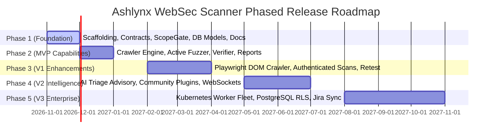

# Implementation Roadmap & Milestone Tracker

**Document Identifier:** ROADMAP-WSS-2026-V1.0  
**Parent Specification:** Master PRD (`PRD-WSS-2026-V2.0-FINAL`)

---

## 1. Roadmap Overview & Release Strategy

---

## 2. Release Allocation Matrix

| Release | Focus Area | Key Deliverables | Status |
| :--- | :--- | :--- | :--- |
| **Phase 1** | Foundation & Architecture | Monorepo scaffolding, ScopeGate Anti-SSRF, Database models, Shared schemas, Pytest foundation, Documentation suite. | **COMPLETED** |
| **Phase 2A** | Reconnaissance & HTTP Crawler | Bounded Async Crawler, URL Normalizer, Passive Form Extractor, Robots/Sitemap parser, JS AST Route Finder, Technology Fingerprinter, Recon CLI. | **COMPLETED** |
| **Phase 2B** | Passive HTTP Security Analysis Engine | 6 Passive analyzers (Headers, Cookies, CORS, Disclosure, HTTPS Transport, HTML DOM), Evidence sealing (SHA-256), False-positive suppression, API & Crawler integration. | **COMPLETED** |
| **MVP (2C)** | Reporting & Verifier Packaging | PDF/Markdown/SARIF/JSON reporting generation, unified CLI scan workflows. | Ready for Implementation |
| **V1** | Rich Web App & APIs | Playwright DOM navigation, Form-based authenticated session replay, OpenAPI/GraphQL fuzzing, Retest engine. | Planned |
| **V2** | Ecosystem & Intelligence | AI-assisted remediation suggestions, Sandboxed plugin runtime, WebSocket testing. | Planned |
| **V3** | Enterprise Multi-Tenant | Distributed Kubernetes worker pools, Row-Level Security, Jira/DefectDojo bidirectional sync. | Planned |
