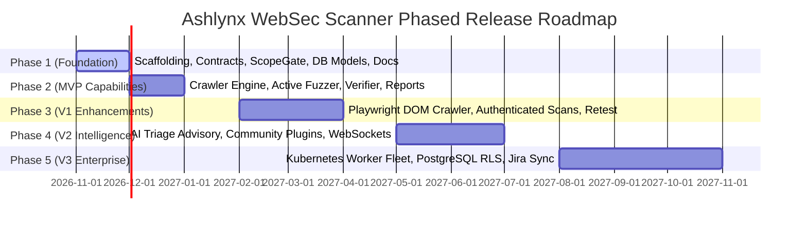

# Implementation Roadmap & Milestone Tracker

**Document Identifier:** ROADMAP-WSS-2026-V1.0  
**Parent Specification:** Master PRD (`PRD-WSS-2026-V2.0-FINAL`)

---

## 1. Roadmap Overview & Release Strategy

---

## 2. Release Allocation Matrix

| Release | Focus Area | Key Deliverables | Status |
| :--- | :--- | :--- | :--- |
| **Phase 1** | Foundation & Architecture | Monorepo scaffolding, ScopeGate Anti-SSRF, Database models, Shared schemas, Pytest foundation, Documentation suite. | **COMPLETED** |
| **Phase 2A** | Reconnaissance & HTTP Crawler | Bounded Async Crawler, URL Normalizer, Passive Form Extractor, Robots/Sitemap parser, JS AST Route Finder, Technology Fingerprinter, Recon CLI. | **COMPLETED** |
| **Phase 2B** | Passive HTTP Security Analysis Engine | 6 Passive analyzers (Headers, Cookies, CORS, Disclosure, HTTPS Transport, HTML DOM), Evidence sealing (SHA-256), False-positive suppression, API & Crawler integration. | **COMPLETED** |
| **Phase 2C** | Unified Reporting & Scan CLI Orchestration | Unified finding contract, Scan lifecycle state machine (`QUEUED` -> `RUNNING` -> `COMPLETED`/`FAILED`/`CANCELLED`), Configurable scan profiles & resource limits, Multi-format report generation (JSON, HTML, Markdown), Stored XSS defense, Path traversal prevention, CLI scan orchestration & report export. | **COMPLETED** |
| **Phase 3** | Active Vulnerability Detection Engine | 6 Active analyzers (SQLi error & two-phase boolean verification, XSS inert canary reflection in HTML/Attr/JS, Misconfiguration bounded checks, Safe SSRF candidate detection, Safe XXE parser entity expansion, Authentication session security), RequestBudgetTracker, ScopeGate egress enforcement, ScanOrchestrator active pipeline integration, Active REST API (`/api/v1/active/*`), and CLI active profiles (`safe-active`, `standard-active`). | **COMPLETED** |
| **Phase 4** | Advanced Attack Surface Discovery & Intelligence | 8 Discovery Subsystems (Endpoint Discovery Engine, JS Static Intelligence, Parameter Intelligence & Heuristic Classification, API Inventory & Versioning, Bounded Asset Inventory, Advanced Technology Multi-Signal Fingerprinting, In-Memory Attack Surface Graph with Cytoscape/JSON export, Evidence-Based Exploration Prioritization), Scan Lifecycle & Unified Report Integration, REST API (`/api/v1/discovery/*`), CLI `ashlynx attack-surface`, and Frontend Attack Surface Dashboard (`/attack-surface`). | **COMPLETED** |
| **Phase 5** | Advanced Vulnerability Intelligence & Validation Engine (AVIVE) | Unified Finding Normalization & Fingerprinting, Traceable Correlation & Deduplication (`DUPLICATE`, `RELATED`, `POTENTIALLY_CORRELATED`, `INDEPENDENT`), Explainable Evidence Quality & Confidence Engine (`LOW`/`MEDIUM`/`HIGH`), Controlled Safe Validation Lifecycle & Audit Trail, Contextual Risk Assessment Engine (independent of CVSS), Structured CWE/OWASP Remediation Intelligence, Live `/api/v1/findings/*` & `/scans/{id}/intelligence` APIs, CLI `ashlynx findings`, Enhanced Reports, and Phase 5 Findings Intelligence UI (`/findings`). | **COMPLETED** |
| **V1** | Rich Web App & APIs | Playwright DOM navigation, Form-based authenticated session replay, OpenAPI/GraphQL fuzzing, Retest engine. | Planned |
| **V2** | Ecosystem & Intelligence | AI-assisted remediation suggestions, Sandboxed plugin runtime, WebSocket testing. | Planned |
| **V3** | Enterprise Multi-Tenant | Distributed Kubernetes worker pools, Row-Level Security, Jira/DefectDojo bidirectional sync. | Planned |
