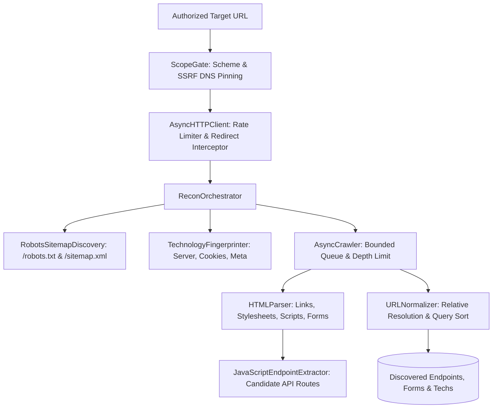

# Phase 2A — Reconnaissance & HTTP Crawler Architecture Specification

**Document Identifier:** RECON-WSS-2026-V1.0  
**Parent Specification:** Master PRD (`PRD-WSS-2026-V2.0-FINAL`)  
**Status:** Implemented & Validated  

---

## 1. Overview & Module Responsibilities

The Phase 2A Reconnaissance & HTTP Crawler Engine discovers and structures the authorized web application attack surface without executing invasive exploits or submitting state-changing forms.



### Module Directory Breakdown

| Subsystem | File Path | Responsibilities |
| :--- | :--- | :--- |
| **Normalizer** | `backend/app/scanner/crawler/normalizer.py` | Canonicalizes URLs, removes fragments, collapses redundant slashes, deterministically sorts queries, categorizes endpoints. |
| **HTTP Client** | `backend/app/scanner/crawler/client.py` | Scope-gated async HTTP client with custom redirect verification and rate limit throttling. |
| **HTML Parser** | `backend/app/scanner/crawler/parser.py` | Extracts anchor tags, meta tags, and passive form metadata (`<form>`, `<input>`, `<select>`, `<textarea>`). |
| **Robots & Sitemap** | `backend/app/scanner/reconnaissance/robots_sitemap.py` | Parses `/robots.txt` disallows/allows and recursively traverses `/sitemap.xml` / sitemap indexes. |
| **JS Route Extractor** | `backend/app/scanner/reconnaissance/js_analyzer.py` | Identifies candidate REST/API routes in static JavaScript files. |
| **Fingerprinter** | `backend/app/scanner/fingerprinting/technologies.py` | Passive technology detection via headers (`Server`, `X-Powered-By`), cookies, and HTML generator tags. |
| **Crawler Engine** | `backend/app/scanner/crawler/crawler.py` | Bounded asynchronous crawler managing visited sets, queues, and concurrency semaphores. |
| **Recon Orchestrator**| `backend/app/scanner/reconnaissance/orchestrator.py`| Master workflow pipeline coordinating all discovery components and aggregating metrics. |

---

## 2. Crawling Lifecycle & Security Invariants

1. **Pre-Flight Gate:** Before every request, `ScopeGate.pre_flight_check()` resolves the hostname to an IP and blocks RFC 1918 private subnets, loopbacks, and cloud metadata (`169.254.169.254`).
2. **Redirect Validation:** `AsyncHTTPClient` disables automatic redirects (`follow_redirects=False`) and manually passes every `Location` header to `ScopeGate.validate_redirect()` before following.
3. **Passive Metadata Collection:** Form actions and fields are inventoried without form submission. No state-altering requests (`POST`, `PUT`, `DELETE`) are fired against the target.
4. **Destructive Path Exclusion:** Destructive patterns (`/logout`, `/delete`, `/destroy`) are automatically identified and skipped by `URLNormalizer.is_destructive_url()`.

---

## 3. API Contracts (`/api/v1/recon/`)

- `POST /api/v1/recon/start` — Launch an authorized reconnaissance session.
- `GET /api/v1/recon/{id}/status` — Retrieve progress, crawl depth, and summary counts.
- `GET /api/v1/recon/{id}/endpoints` — Paginated list of discovered endpoints with categories and query parameter lists.
- `GET /api/v1/recon/{id}/technologies` — List of detected technologies, versions, confidence scores, and evidence.
- `POST /api/v1/recon/{id}/cancel` — Cancel an in-flight reconnaissance job.

---

## 4. CLI Usage

```bash
# Execute reconnaissance on an authorized target
ashlynx recon --target https://app.example.com --authorized --max-depth 3 --max-pages 100

# JSON output for automated scripting
ashlynx recon --target https://app.example.com --authorized --format json > recon.json
```
