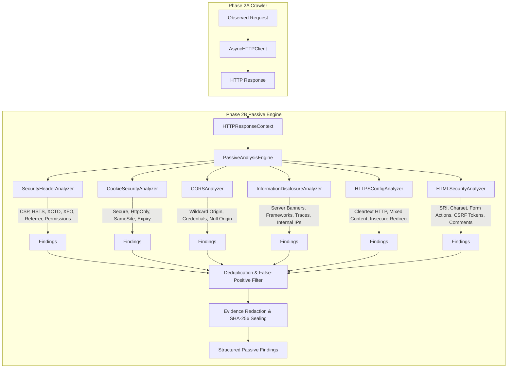

# PHASE 2B — PASSIVE HTTP SECURITY CHECK SPECIFICATION

**Document Identifier:** SPEC-WSS-2026-PHASE2B  
**Author:** Ashlynx WebSec Core Security Engineering Team  
**Milestone:** Phase 2B — Passive HTTP Security Analysis Engine  
**Release Horizon:** MVP  
**Status:** Approved & Implemented  

---

## 1. Executive Overview

Phase 2B of the Ashlynx WebSec Scanner establishes a zero-overhead, non-destructive **Passive HTTP Security Analysis Engine**. Rather than firing active exploit payloads or invasive mutation probes, the passive engine inspects observed HTTP transactions (headers, cookies, status codes, CORS directives, SSL/TLS characteristics, and HTML DOM structures) already collected during Phase 2A reconnaissance and crawling.

### 1.1 Non-Destructive Principles & Security Invariants
1. **Zero External Attack Traffic:** No new network requests or injection vectors are generated during passive analysis.
2. **Deterministic Evidence Sealing:** Every finding captures redacted request/response snippets cryptographically bound via SHA-256 seals.
3. **Strict False-Positive Suppression:** Findings are flagged only upon concrete configuration deficiencies or deterministic signature matches. Fully hardened baselines yield zero findings.
4. **ScopeGate Adherence:** All URLs analyzed originate from explicitly authorized, scope-validated target boundaries.

---

## 2. Architecture & Component Interaction

---

## 3. Analyzer Modules & Rule Taxonomy

### 3.1 Security Header Policy Analyzer (`SEC-HDR-ANALYZER`)
Analyzes HTTP response headers to identify missing or misconfigured security policies.

| Rule ID | Title | CWE | OWASP | Severity |
| :--- | :--- | :--- | :--- | :--- |
| `PASSIVE-HDR-CSP-MISSING` | Missing Content-Security-Policy (CSP) | CWE-693 | A05:2021 | MEDIUM |
| `PASSIVE-HDR-CSP-UNSAFE` | CSP Uses 'unsafe-inline' or 'unsafe-eval' | CWE-693 | A05:2021 | MEDIUM |
| `PASSIVE-HDR-CSP-NO-DEFAULT` | CSP Missing default-src Fallback | CWE-693 | A05:2021 | LOW |
| `PASSIVE-HDR-CSP-WILDCARD` | CSP script-src or default-src Contains Wildcard `*` | CWE-693 | A05:2021 | MEDIUM |
| `PASSIVE-HDR-HSTS-MISSING` | Missing Strict-Transport-Security on HTTPS | CWE-319 | A02:2021 | MEDIUM |
| `PASSIVE-HDR-HSTS-SHORT-MAXAGE` | HSTS max-age Less Than 120 Days | CWE-319 | A02:2021 | LOW |
| `PASSIVE-HDR-HSTS-NO-SUBDOMAINS` | HSTS Missing includeSubDomains | CWE-319 | A02:2021 | LOW |
| `PASSIVE-HDR-XCTO-MISSING` | Missing or Invalid X-Content-Type-Options: nosniff | CWE-693 | A05:2021 | LOW |
| `PASSIVE-HDR-XFO-MISSING` | Missing Anti-Clickjacking Header (XFO / frame-ancestors) | CWE-1021 | A05:2021 | MEDIUM |
| `PASSIVE-HDR-XFO-DEPRECATED` | Deprecated X-Frame-Options ALLOW-FROM Directive | CWE-1021 | A05:2021 | LOW |
| `PASSIVE-HDR-REFERRER-MISSING` | Missing Referrer-Policy Header | CWE-200 | A05:2021 | LOW |
| `PASSIVE-HDR-REFERRER-UNSAFE` | Referrer-Policy Set to unsafe-url or no-referrer-when-downgrade | CWE-200 | A05:2021 | LOW |
| `PASSIVE-HDR-PERMISSIONS-MISSING`| Missing Permissions-Policy Header | CWE-693 | A05:2021 | LOW |
| `PASSIVE-HDR-PERMISSIONS-PERMISSIVE`| Permissions-Policy Grants Wildcard Feature Access | CWE-693 | A05:2021 | LOW |

### 3.2 Cookie Security Flag Analyzer (`COOKIE-SEC-ANALYZER`)
Evaluates all observed `Set-Cookie` headers against defensive isolation criteria.

| Rule ID | Title | CWE | OWASP | Severity |
| :--- | :--- | :--- | :--- | :--- |
| `PASSIVE-COOKIE-PLAINTEXT-TRANSMISSION` | Cookie Transmitted Over Cleartext HTTP | CWE-319 | A02:2021 | HIGH/MEDIUM |
| `PASSIVE-COOKIE-SECURE-MISSING` | Cookie Missing Secure Attribute on HTTPS | CWE-614 | A05:2021 | MEDIUM/LOW |
| `PASSIVE-COOKIE-HTTPONLY-MISSING` | Sensitive/Session Cookie Missing HttpOnly Flag | CWE-1004 | A05:2021 | MEDIUM |
| `PASSIVE-COOKIE-SAMESITE-MISSING` | Cookie Missing SameSite Flag | CWE-1275 | A01:2021 | LOW |
| `PASSIVE-COOKIE-SAMESITE-NONE-INSECURE` | SameSite=None Set Without Secure Flag | CWE-1275 | A05:2021 | MEDIUM |
| `PASSIVE-COOKIE-EXCESSIVE-MAXAGE` | Session Cookie Has Expiration Exceeding 1 Year | CWE-613 | A07:2021 | LOW |

### 3.3 CORS Policy Configuration Analyzer (`CORS-SEC-ANALYZER`)
Detects insecure cross-origin resource access patterns.

| Rule ID | Title | CWE | OWASP | Severity |
| :--- | :--- | :--- | :--- | :--- |
| `PASSIVE-CORS-WILDCARD-WITH-CREDENTIALS` | CORS Combines Wildcard/Null Origin with Credentials | CWE-942 | A01:2021 | HIGH |
| `PASSIVE-CORS-NULL-ORIGIN` | CORS Allows Origin: null | CWE-942 | A01:2021 | MEDIUM |
| `PASSIVE-CORS-WILDCARD-ORIGIN` | Permissive Access-Control-Allow-Origin: * on API | CWE-942 | A01:2021 | LOW |
| `PASSIVE-CORS-OVERLY-PERMISSIVE-METHODS` | Wildcard Allowed HTTP Methods | CWE-942 | A01:2021 | LOW |

### 3.4 Information Disclosure & Diagnostic Leak Analyzer (`INFO-DISC-ANALYZER`)
Identifies metadata leaks, diagnostic banners, internal network details, and database URIs.

| Rule ID | Title | CWE | OWASP | Severity |
| :--- | :--- | :--- | :--- | :--- |
| `PASSIVE-INFO-SERVER-VERSION` | Server Header Exposes Granular Version | CWE-200 | A05:2021 | LOW |
| `PASSIVE-INFO-FRAMEWORK-DISCLOSURE` | Framework Disclosed (X-Powered-By, X-AspNet-Version) | CWE-200 | A05:2021 | LOW |
| `PASSIVE-INFO-DEBUG-HEADERS` | Active Profiler/Debug Headers in Production | CWE-215 | A05:2021 | MEDIUM |
| `PASSIVE-INFO-STACKTRACE-BODY` | Detailed Exception Stack Trace Disclosed in Body | CWE-209 | A05:2021 | HIGH |
| `PASSIVE-INFO-INTERNAL-IP-LEAK` | Internal RFC 1918 Private IP Disclosed in Body | CWE-200 | A05:2021 | LOW |
| `PASSIVE-INFO-DATABASE-URI-LEAK` | Database Connection String / URI Disclosed | CWE-200 | A02:2021 | HIGH |

### 3.5 HTTPS Transport & Mixed-Content Analyzer (`HTTPS-CONFIG-ANALYZER`)
Audits protocol security and transport-layer boundary integrity.

| Rule ID | Title | CWE | OWASP | Severity |
| :--- | :--- | :--- | :--- | :--- |
| `PASSIVE-HTTPS-INSECURE-SCHEME` | Resource Served Over Cleartext HTTP | CWE-319 | A02:2021 | MEDIUM |
| `PASSIVE-HTTPS-INSECURE-REDIRECT` | HTTPS Endpoint Downgrades to Cleartext HTTP | CWE-319 | A02:2021 | HIGH |
| `PASSIVE-HTTPS-ACTIVE-MIXED-CONTENT` | HTTPS Document Loads Active Content Over HTTP | CWE-311 | A02:2021 | HIGH |
| `PASSIVE-HTTPS-PASSIVE-MIXED-CONTENT` | HTTPS Document Loads Images/Media Over HTTP | CWE-311 | A02:2021 | LOW |

### 3.6 HTML DOM & Document Security Analyzer (`HTML-SEC-ANALYZER`)
Examines client-side markup, third-party CDN dependencies, forms, and comments.

| Rule ID | Title | CWE | OWASP | Severity |
| :--- | :--- | :--- | :--- | :--- |
| `PASSIVE-HTML-MISSING-CHARSET` | Missing `<meta charset>` Encoding Tag | CWE-436 | A05:2021 | INFORMATIONAL |
| `PASSIVE-HTML-MISSING-VIEWPORT` | Missing `<meta name="viewport">` Tag | CWE-1021 | A05:2021 | INFORMATIONAL |
| `PASSIVE-HTML-SRI-MISSING` | External CDN Scripts Missing Subresource Integrity | CWE-353 | A08:2021 | LOW |
| `PASSIVE-HTML-FORM-CLEAR-ACTION` | Form Submits to Cleartext HTTP Action | CWE-319 | A02:2021 | HIGH |
| `PASSIVE-HTML-FORM-PASSWORD-CLEAR` | Password Field Rendered on Insecure / HTTP Page | CWE-319 | A02:2021 | HIGH |
| `PASSIVE-HTML-FORM-NO-CSRF-TOKEN` | State-Modifying POST Form Missing Anti-CSRF Token | CWE-352 | A01:2021 | MEDIUM |
| `PASSIVE-HTML-SENSITIVE-COMMENT` | Sensitive Annotations or Credentials in HTML Comment | CWE-615 | A05:2021 | LOW |

---

## 4. Evidence Integrity, Redaction & Verification

1. **In-Memory Redaction:**
   Before persisting any evidence string or calculating integrity seals, `EvidenceRedactor` strips:
   - Bearer/Basic authorization tokens (`Authorization: Bearer [REDACTED]`)
   - Session cookies (`session=[REDACTED]`)
   - JSON credentials (`"password": "[REDACTED]"`)
   - Credit card numbers (`[REDACTED_CREDIT_CARD]`)
2. **Cryptographic Sealing:**
   SHA-256 seal is computed over:
   $$\text{SHA256}(\text{redacted\_request} + \text{"---EVIDENCE\_BOUNDARY---"} + \text{redacted\_response})$$
3. **Status Classification:**
   All configuration observations are designated with evidence-based status:
   - `DETECTED`: Objectively identified configuration deficiency or missing defensive header.
   - `SUSPECTED`: Potential vulnerability indicator requiring manual context validation.
   - `VERIFIED`: Deterministic verification with reproducible cryptographic evidence.
