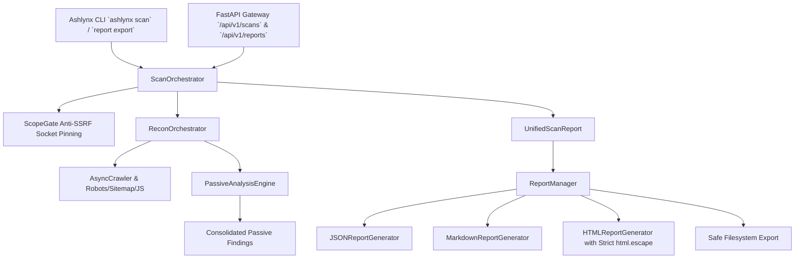

# Phase 2C — Unified Reporting & Scan CLI Orchestration Specification

**Document Identifier:** SPEC-WSS-2026-PHASE2C  
**Author:** Principal Software Architect, Application Security Architect  
**Status:** IMPLEMENTED  
**Date:** 2026-11-24  

---

## 1. Executive Summary

Phase 2C delivers the Unified Reporting and Scan CLI Orchestration framework for Ashlynx WebSec Scanner. It unifies reconnaissance and passive security findings into a standardized data model, enforces explicit scan lifecycle state transitions, provides multi-format report generation (JSON, HTML, Markdown), defends against report-based attacks (Stored XSS and Path Traversal), and provides a polished, interactive Command-Line Interface (CLI).

---

## 2. Core Architecture

---

## 3. Scan Lifecycle State Machine

The scan lifecycle is managed deterministically through the following states:

1. **`QUEUED`**: The scan job has been registered, parameters validated against presets, and ScopeGate initialized.
2. **`RUNNING`**: Active crawling and passive analysis are underway. `started_at` timestamp is recorded.
3. **`COMPLETED`**: Crawling and analysis have concluded successfully; findings are aggregated into `UnifiedScanReport`; `completed_at` and `duration_seconds` are recorded.
4. **`CANCELLED`**: The user issued a cooperative cancellation signal (Ctrl+C in CLI or `POST /api/v1/scans/{id}/cancel`); in-flight network sockets and crawler workers are cleanly terminated.
5. **`FAILED`**: An unhandled exception or critical pre-flight failure occurred; `error_message` is persisted and an error-state report is constructed.

---

## 4. Scan Profiles & Resource Limits

| Profile | Crawl Depth | Max URLs | Concurrency | Rate Limit | Primary Use Case |
| :--- | :---: | :---: | :---: | :---: | :--- |
| **`PASSIVE_DISCOVERY`** | 2 | 100 | 3 | 5.0 RPS | Low-impact attack surface mapping |
| **`QUICK_ASSESSMENT`** | 3 | 300 | 5 | 10.0 RPS | Default safe assessment profile |
| **`FULL_ASSESSMENT`** | 5 | 1000 | 8 | 15.0 RPS | Deep audit of large applications |
| **`SAFE_MODE`** | 2 | 50 | 1 | 2.0 RPS | Fragile or sensitive environments |
| **`API_TARGETED`** | 3 | 500 | 5 | 10.0 RPS | Headless and REST API architectures |

*Note: CLI flags (`--max-depth`, `--max-urls`, `--concurrency`, `--rate-limit`) take strict precedence over profile defaults.*

---

## 5. Security & Threat Mitigation

### 5.1 Stored XSS & HTML Injection Defense in Reports
Target applications often reflect user-controlled payloads or return malicious strings designed to attack security analysts when viewing reports in web browsers.
- **Invariant:** In `HTMLReportGenerator`, **every dynamic parameter** (target URL, finding title, description, remediation guidance, URL endpoints, parameters, detection evidence, technology names) is sanitized using `html.escape(value, quote=True)`.
- Verified via unit test suite: Raw `<script>`, `onerror=`, `<svg onload>`, and quotes are transformed into HTML character entities (`&lt;script&gt;`, `&quot;&gt;&lt;img`).

### 5.2 Arbitrary File Overwrite & Path Traversal Defense
Reports can be exported to user-supplied destinations on disk.
- **Invariant:** `ReportManager.validate_and_resolve_output_path()` strictly inspects the destination path:
  - Rejects any path component containing `..` (directory traversal sequence).
  - Enforces mandatory boundaries if an `allowed_root_dir` is configured.
  - Hard-blocks writes to protected operating system directories (`C:\Windows`, `/etc`, `/root`, `/bin`, `/sbin`).

### 5.3 Safety Gate Verification
Scanning third-party applications without explicit authorization is unethical and potentially illegal.
- **Invariant:** `ashlynx scan` requires explicit confirmation via `--authorized` / `-a`.
- Invocations lacking this flag fail immediately with exit code 2 and a descriptive warning without sending a single network packet.

---

## 6. Report Formats & Output Specs

1. **JSON (`ReportFormat.JSON`)**: Complete structured machine-readable format conforming to `UnifiedScanReport` schema. Media type: `application/json`.
2. **Markdown (`ReportFormat.MARKDOWN`)**: GitHub Flavored Markdown with executive tables, technology inventory, and detailed finding cards with redacted HTTP evidence. Media type: `text/markdown; charset=utf-8`.
3. **HTML (`ReportFormat.HTML`)**: Self-contained, responsive, dark-themed HTML report featuring executive risk scorecards, technology tables, and finding cards with print-media styling. Media type: `text/html; charset=utf-8`.
