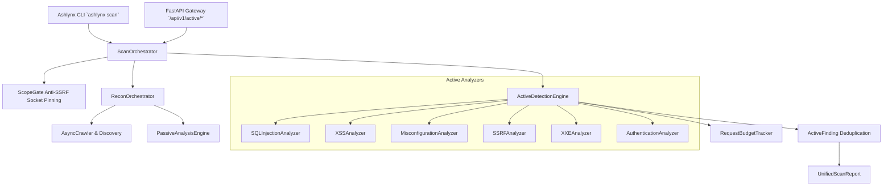

# Phase 3 — Active Vulnerability Detection Engine Specification

**Document Identifier:** SPEC-WSS-2026-PHASE3  
**Author:** Principal Application Security Engineer, Security Scanner Architect  
**Status:** IMPLEMENTED  
**Date:** 2026-11-24  

---

## 1. Executive Summary

Phase 3 delivers the Active Vulnerability Detection Engine for **Ashlynx WebSec Scanner (`AWSS-CORE`)**.

Building upon the Reconnaissance Crawler (Phase 2A), Passive HTTP Security Analysis Engine (Phase 2B), and Unified Reporting Orchestration (Phase 2C), Phase 3 provides a modular, controlled, and non-destructive active probing framework.

All active checks operate under non-negotiable safety constraints:
1. **ScopeGate & Anti-SSRF Socket Pinning:** All outbound probes resolve and pin IP addresses, blocking private subnets (RFC 1918), loopback, link-local, and cloud metadata (`169.254.169.254`).
2. **Strictly Non-Destructive Payloads:** Prohibits data modification, state deletion, database extraction, or application denial-of-service.
3. **Inert Markers & Deterministic Verification:** Employs non-executing canaries and two-phase mathematical invariants rather than malicious exploits.
4. **Mandatory Authorization Gate:** Active probes are rejected unless explicit authorization (`--authorized` / `-a` or `authorized: true`) is confirmed.

---

## 2. Architecture Overview

---

## 3. Active Detection Modules Catalogue

### Module 3.1: SQL Injection Detection (`sqli.py`)
- **Analyzer ID:** `ACT-SQLI-ANALYZER`
- **Category:** Injection (`A03:2021 - Injection`, `CWE-89`)
- **Supported Rules:**
  - `ACT-SQLI-ERROR`: Database syntax error signatures (MySQL, PostgreSQL, SQLite, MSSQL, Oracle). Classification: `SUSPECTED`, Severity: `HIGH`, CVSS: 8.5.
  - `ACT-SQLI-BOOLEAN`: Two-phase deterministic mathematical invariant verification (`AND 8943=8943` vs `AND 8943=8944`). Classification: `VERIFIED`, Severity: `CRITICAL`, CVSS: 9.4.
- **Safety Invariant:** Prohibits `DROP`, `DELETE`, `UPDATE`, `INSERT`, `SLEEP`, `BENCHMARK`, or data extraction.

### Module 3.2: Cross-Site Scripting (XSS) Detection (`xss.py`)
- **Analyzer ID:** `ACT-XSS-ANALYZER`
- **Category:** Cross-Site Scripting (`A03:2021 - Injection`, `CWE-79`)
- **Supported Rules:**
  - `ACT-XSS-REFLECTED-HTML`: Raw reflection in HTML body context (`<ashxtag>`). Classification: `VERIFIED`, Severity: `HIGH`, CVSS: 7.5.
  - `ACT-XSS-REFLECTED-ATTR`: Attribute breakout reflection without quote escaping (`"ashxattr`). Classification: `VERIFIED`, Severity: `HIGH`, CVSS: 7.2.
  - `ACT-XSS-REFLECTED-JS`: Unescaped reflection inside `<script>` code block (`'-ashxjs-'`). Classification: `VERIFIED`, Severity: `HIGH`, CVSS: 8.0.
- **Safety Invariant:** Uses inert, non-executing alphanumeric canaries. Never executes malicious JavaScript, never attempts session theft or DOM disruption.

### Module 3.3: Security Misconfiguration Detection (`misconfiguration.py`)
- **Analyzer ID:** `ACT-MISCONFIG-ANALYZER`
- **Category:** Security Misconfiguration (`A05:2021 - Security Misconfiguration`)
- **Supported Rules:**
  - `ACT-MISCONFIG-DIRLIST`: Exposed directory listings (`CWE-548`, Medium, CVSS 5.3).
  - `ACT-MISCONFIG-DIAGNOSTIC`: Publicly accessible Spring Boot Actuator / Profiler / phpinfo (`CWE-215`, High/Medium, CVSS 7.5).
  - `ACT-MISCONFIG-UNSAFE-METHODS`: Unsafe HTTP TRACE/OPTIONS method advertised (`CWE-650`, Low, CVSS 3.7).
  - `ACT-MISCONFIG-SENSITIVE-FILES`: Exposed `.env`, `.git/HEAD`, `web.config` (`CWE-552`, High, CVSS 7.5).
  - `ACT-MISCONFIG-OPEN-REDIRECT`: Insecure off-origin redirection (`CWE-601`, Medium, CVSS 6.1).
- **Safety Invariant:** Strictly bounded check list (maximum 10 paths per origin). Absolutely no brute-force directory fuzzing.

### Module 3.4: Server-Side Request Forgery Detection (`ssrf.py`)
- **Analyzer ID:** `ACT-SSRF-ANALYZER`
- **Category:** Server-Side Request Forgery (`A10:2021 - SSRF`, `CWE-918`)
- **Supported Rules:**
  - `ACT-SSRF-URL-PARAM`: URL parameter provoking outbound connection attempt (`CWE-918`, High, CVSS 7.5). Classification: `SUSPECTED`.
- **Safety Invariant:** Probes exclusively use safe synthetic non-routable domains (`scan-probe.invalid`). NEVER accesses cloud metadata, localhost, link-local, or private RFC 1918 subnets.

### Module 3.5: XML External Entity Detection (`xxe.py`)
- **Analyzer ID:** `ACT-XXE-ANALYZER`
- **Category:** XML External Entity (`A05:2021 - Security Misconfiguration`, `CWE-611`)
- **Supported Rules:**
  - `ACT-XXE-ENTITY-EXPANSION`: XML parser entity expansion enabled (`CWE-611`, High, CVSS 8.2). Classification: `VERIFIED`.
- **Safety Invariant:** Uses benign local inline entity definitions without `SYSTEM` references. Never reads local files or makes outbound network calls. Scanner-side parsing explicitly disables external entities.

### Module 3.6: Authentication & Session Security (`authentication.py`)
- **Analyzer ID:** `ACT-AUTH-ANALYZER`
- **Category:** Authentication & Session Management (`A07:2021`, `A02:2021`)
- **Supported Rules:**
  - `ACT-AUTH-SESSION-URL`: Session identifier in URL query string (`CWE-598`, Medium, CVSS 5.3).
  - `ACT-AUTH-CLEAR-TEXT-LOGIN`: Login surface accessible over unencrypted HTTP (`CWE-319`, High, CVSS 7.4).
  - `ACT-AUTH-FIXATION`: Session cookie unchanged across auth context transition (`CWE-384`, Medium, CVSS 6.5).
- **Safety Invariant:** Strictly avoids credential guessing, password spraying, brute force, or account takeover.

---

## 4. Scan Profiles & Budgets

| Profile | Active Probing | Request Budget | Concurrency | Rate Limit | Primary Purpose |
| :--- | :---: | :---: | :---: | :---: | :--- |
| **`PASSIVE_ONLY`** | Disabled | 0 | 3 | 5.0 RPS | Zero-probe passive observation |
| **`SAFE_ACTIVE`** | Enabled | 60 | 2 | 3.0 RPS | Default safe assessment profile |
| **`STANDARD_ACTIVE`** | Enabled | 250 | 4 | 8.0 RPS | Full two-phase active audit |
| **`FULL_ASSESSMENT`** | Enabled | 500 | 8 | 15.0 RPS | Comprehensive deep audit |
| **`API_TARGETED`** | Enabled | 100 | 5 | 10.0 RPS | REST API & microservices assessment |
