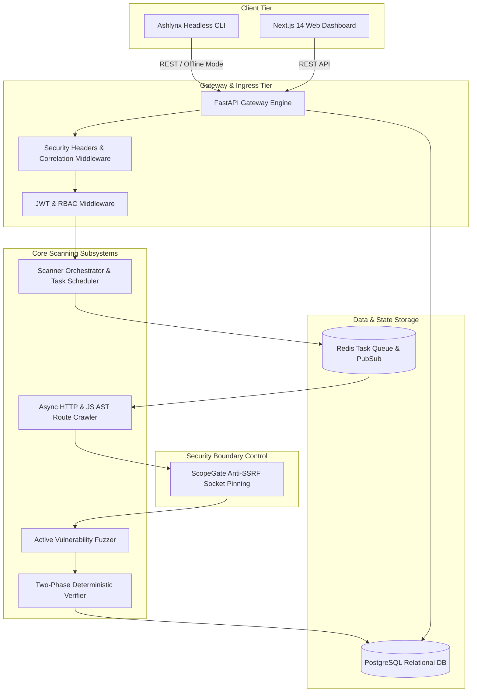

# Software Architecture Specification
## Ashlynx WebSec Scanner (AWSS-CORE)

**Document Identifier:** ARCH-WSS-2026-V1.0  
**Classification:** Internal — Confidential (AshlynxCyber)  
**Parent Specification:** Master PRD (`PRD-WSS-2026-V2.0-FINAL`)

---

## 1. Architectural Philosophy & Overview
Ashlynx WebSec Scanner is engineered as a hybrid web application security assessment and Dynamic Application Security Testing (DAST) platform. It provides two operational entry points over a single unified core engine:
1. **Interactive Web Dashboard:** A multi-tenant, responsive web application for project governance, scan monitoring, evidence inspection, and executive reporting.
2. **Headless Command-Line Interface (CLI):** A scriptable, container-friendly CLI designed for security consultants, bug bounty researchers, and DevSecOps CI/CD pipelines.

---

## 2. Subsystem Decomposition & Boundaries

### 2.1 API Gateway & Orchestration (`backend/app/api/` & `backend/app/scanner/orchestrator/`)
- Exposes typed REST endpoints under `/api/v1`.
- Enforces request validation via Pydantic v2 schemas.
- Manages scan job state transitions:
  $$\text{QUEUED} \rightarrow \text{PRE\_FLIGHT} \rightarrow \text{CRAWLING} \rightarrow \text{ACTIVE\_SCAN} \rightarrow \text{VERIFYING} \rightarrow \text{COMPLETED}$$
- Implements worker heartbeat tracking and crash state recovery.

### 2.2 Security Egress Gate (`backend/app/scanner/scope/scope_gate.py`)
- **Anti-SSRF Protection:** Pre-flight DNS resolution with strict IP address validation against RFC 1918, RFC 3927 (Cloud Metadata `169.254.169.254`), loopback (`127.0.0.0/8`), and multicast.
- **Socket IP Pinning:** Directly pins outbound HTTP sockets to the resolved IP to prevent DNS rebinding attacks.
- **Scope Boundary Enforcement:** Discards all out-of-scope URLs before active payloads are fired.

### 2.3 Reconnaissance & Crawling (`backend/app/scanner/crawler/`)
- Asynchronous recursive HTTP crawler with configurable crawl depth and URL caps.
- Client-side JavaScript route extractor parsing linked `.js` bundles and sourcemaps using AST/regex pattern matching.
- Automatic exclusion of destructive paths (e.g., `/logout`, `/delete`, `/destroy`).

### 2.4 Active Detection & Two-Phase Verification (`backend/app/scanner/verification/`)
- **Phase 1 (Heuristic Detection):** Injection of boundary probes to observe behavioral anomalies (HTTP status, timing, content length).
- **Phase 2 (Deterministic Verification):** Second-order mathematical invariant probes (for SQLi/SSTI) or out-of-band listener callbacks (for SSRF) to mathematically confirm vulnerability presence before assigning `VERIFIED` status.

### 2.5 Evidence Management & Chain of Custody (`backend/app/scanner/evidence/`)
- In-memory redaction of sensitive credentials, Bearer tokens, cookies, and passwords.
- Cryptographic SHA-256 seal generated for every HTTP request/response pair.

---

## 3. Deployment Topology
- **Local/Researcher Mode:** Standalone CLI and single-container or Docker Compose setup.
- **Enterprise Cluster Mode:** Horizontally scalable FastAPI pods, Redis task brokers, ephemeral worker pods, and PostgreSQL 16+ with Row-Level Security.
