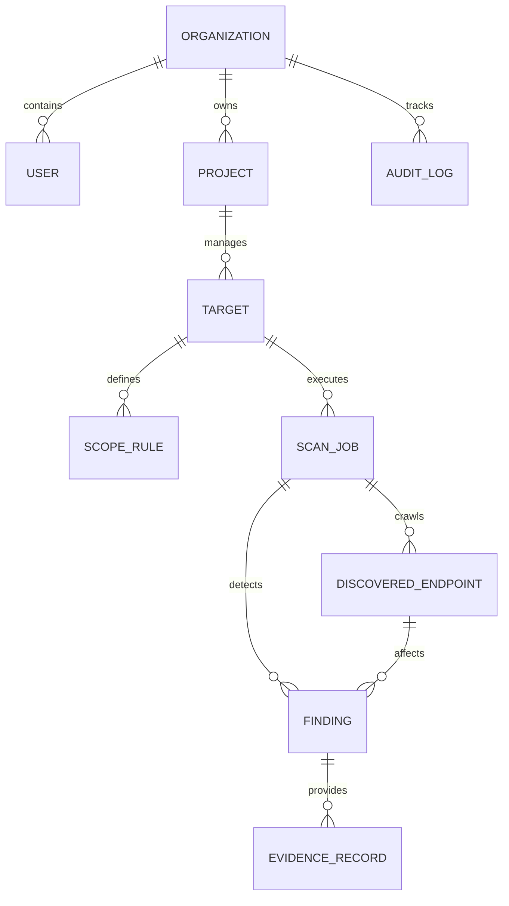

# Database Design & Relational Schema Specification

**Document Identifier:** DB-WSS-2026-V1.0  
**Parent Specification:** Master PRD (`PRD-WSS-2026-V2.0-FINAL`)

---

## 1. Overview & Data Model Architecture
Ashlynx WebSec Scanner utilizes PostgreSQL 16+ as its authoritative system of record. The schema is organized into normalized relational tables using UUID v4 primary keys to prevent resource enumeration attacks.

---

## 2. Table Schemas & Data Dictionary

### 2.1 `organizations`
| Column | Type | Constraints | Description |
| :--- | :--- | :--- | :--- |
| `id` | UUID | PRIMARY KEY, DEFAULT uuid_generate_v4() | Organization identifier |
| `name` | VARCHAR(100) | UNIQUE, NOT NULL | Organization business name |
| `slug` | VARCHAR(100) | UNIQUE, NOT NULL | URL-safe slug |
| `created_at` | TIMESTAMPTZ | NOT NULL, DEFAULT NOW() | Record creation timestamp |
| `updated_at` | TIMESTAMPTZ | NOT NULL, DEFAULT NOW() | Last update timestamp |

### 2.2 `users`
| Column | Type | Constraints | Description |
| :--- | :--- | :--- | :--- |
| `id` | UUID | PRIMARY KEY, DEFAULT uuid_generate_v4() | User identifier |
| `org_id` | UUID | FOREIGN KEY -> organizations(id) ON DELETE CASCADE | Parent organization |
| `email` | VARCHAR(255) | UNIQUE, NOT NULL, INDEXED | User corporate email |
| `hashed_password` | VARCHAR(255) | NOT NULL | Argon2 / bcrypt hash |
| `role` | VARCHAR(50) | NOT NULL, DEFAULT 'Analyst' | RBAC role |
| `is_active` | BOOLEAN | NOT NULL, DEFAULT TRUE | Account state |

### 2.3 `targets`
| Column | Type | Constraints | Description |
| :--- | :--- | :--- | :--- |
| `id` | UUID | PRIMARY KEY | Target identifier |
| `project_id` | UUID | FOREIGN KEY -> projects(id) ON DELETE CASCADE | Associated project |
| `name` | VARCHAR(100) | NOT NULL | Human-readable target name |
| `base_url` | VARCHAR(2048)| NOT NULL | Canonical root target URL |
| `asset_criticality` | FLOAT | NOT NULL, DEFAULT 1.0 | Risk multiplier factor |
| `verified` | BOOLEAN | NOT NULL, DEFAULT FALSE | Ownership verification state |

### 2.4 `scope_rules`
| Column | Type | Constraints | Description |
| :--- | :--- | :--- | :--- |
| `id` | UUID | PRIMARY KEY | Rule identifier |
| `target_id` | UUID | FOREIGN KEY -> targets(id) ON DELETE CASCADE | Associated target |
| `rule_type` | VARCHAR(20) | NOT NULL (INCLUDE or EXCLUDE) | Rule evaluation mode |
| `pattern` | VARCHAR(1024)| NOT NULL | Regex, wildcard, or CIDR |

### 2.5 `scan_jobs`
| Column | Type | Constraints | Description |
| :--- | :--- | :--- | :--- |
| `id` | UUID | PRIMARY KEY | Scan job identifier |
| `target_id` | UUID | FOREIGN KEY -> targets(id) ON DELETE CASCADE | Scanned target |
| `profile` | VARCHAR(50) | NOT NULL | Scan profile name |
| `status` | VARCHAR(50) | NOT NULL, INDEXED | Execution state |
| `max_crawl_depth` | INTEGER | NOT NULL, DEFAULT 3 | Recursive depth limit |
| `urls_crawled` | INTEGER | NOT NULL, DEFAULT 0 | Counter of crawled URLs |
| `findings_count` | INTEGER | NOT NULL, DEFAULT 0 | Counter of detected findings |

### 2.6 `findings`
| Column | Type | Constraints | Description |
| :--- | :--- | :--- | :--- |
| `id` | UUID | PRIMARY KEY | Finding identifier |
| `scan_id` | UUID | FOREIGN KEY -> scan_jobs(id) ON DELETE CASCADE | Parent scan |
| `title` | VARCHAR(255) | NOT NULL | Finding title |
| `cwe_id` | VARCHAR(50) | NOT NULL | Common Weakness Enumeration ID |
| `severity` | VARCHAR(20) | NOT NULL, INDEXED | CRITICAL, HIGH, MEDIUM, LOW, INFO |
| `cvss_score` | FLOAT | NOT NULL | CVSS base score (0.0 - 10.0) |
| `status` | VARCHAR(30) | NOT NULL, INDEXED | Finding state |
| `confidence` | FLOAT | NOT NULL, DEFAULT 0.7 | Confidence factor (1.0 = verified) |

### 2.7 `evidence_records`
| Column | Type | Constraints | Description |
| :--- | :--- | :--- | :--- |
| `id` | UUID | PRIMARY KEY | Evidence identifier |
| `finding_id` | UUID | FOREIGN KEY -> findings(id) ON DELETE CASCADE | Associated finding |
| `request_data` | TEXT | NOT NULL | Redacted raw HTTP request trace |
| `response_data` | TEXT | NOT NULL | Redacted raw HTTP response trace |
| `sha256_hash` | VARCHAR(64) | NOT NULL, INDEXED | Cryptographic integrity hash |
| `probe_type` | VARCHAR(50) | NOT NULL, DEFAULT 'primary' | Primary anomaly vs secondary probe |

---

## 3. Indexing & Multi-Tenancy Strategy
- **Composite Indexes:** `findings(scan_id, severity, status)` for fast dashboard filtering.
- **RLS Readiness (V3):** Tables maintain `org_id` references for PostgreSQL Row-Level Security policies.
